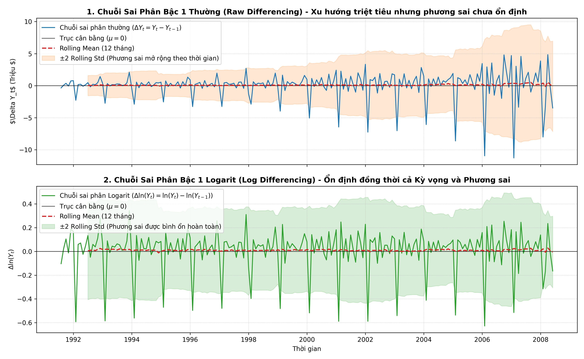
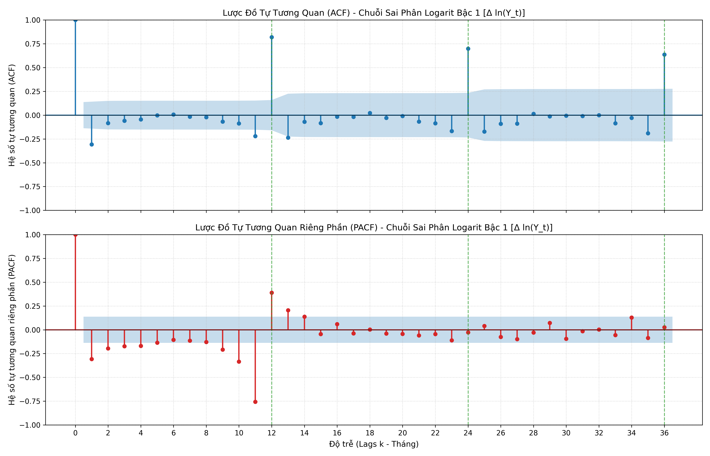

# Tài Liệu Chuyên Sâu: Sai Phân & Phân Tích Lược Đồ ACF / PACF Để Nhận Diện Bậc Mô Hình ARIMA / SARIMA

> **Học phần:** Phân tích Chuỗi Thời Gian (Time Series Analysis & Forecasting)  
> **Nội dung:** Bài 3 (Sai phân bậc 1 & Kiểm định ADF lần 2) và Bài 4 (Khảo sát ACF/PACF & Nhận diện mô hình Box–Jenkins)  
> **Dữ liệu thực nghiệm:** Monthly Anti-diabetic Drug Sales in Australia (`data/raw/a10.csv`)  
> **Notebook thực hành:** [`main.ipynb`](../main.ipynb) / [`scripts/main.ipynb`](../scripts/main.ipynb)

---

## 1. Tổng Quan Phương Pháp Luận Box–Jenkins Trong Nhận Diện Mô Hình

Quy trình Box–Jenkins bao gồm 4 giai đoạn lặp chuẩn mực:
1. **Định danh mô hình (Model Identification):** Kiểm tra tính dừng, xác định bậc sai phân $d$, khảo sát ACF/PACF để ước lượng bậc $p$ và $q$.
2. **Ước lượng tham số (Parameter Estimation):** Sử dụng phương pháp Khả năng tối đa (Maximum Likelihood Estimation - MLE) hoặc Bình phương tối thiểu phi tuyến (NLS).
3. **Chẩn đoán mô hình (Diagnostic Checking):** Kiểm tra phần dư xem đã là Nhiễu trắng (White Noise) hay chưa qua biểu đồ phần dư, ACF phần dư và kiểm định Ljung–Box.
4. **Dự báo (Forecasting):** Sinh dự báo điểm và khoảng tin cậy trên tập Test.

Tài liệu này tập trung giải quyết trọn vẹn và chi tiết nhất **Giai đoạn 1: Sai phân ($d$) và Nhận diện bậc tham số $(p, q)$ qua ACF / PACF** (Bài 3 & Bài 4).

---

## 2. Bài 3: Sai Phân & Kiểm Định Nghiệm Đơn Vị Lần 2 (First-Order Differencing)

### 2.1. Cơ sở toán học của phép sai phân
Khi chuỗi gốc $Y_t$ có xu hướng tăng tuyến tính (Stochastic Trend), chuỗi không dừng về mặt kỳ vọng toán học ($E[Y_t] \neq \text{const}$). Để triệt tiêu thành phần này, ta áp dụng toán tử sai phân thường bậc 1:
$$\Delta Y_t = (1 - B)Y_t = Y_t - Y_{t-1}$$
trong đó $B$ là toán tử lùi (Backshift Operator: $B^k Y_t = Y_{t-k}$).

### 2.2. Kết quả kiểm định ADF sau sai phân bậc 1
Bảng đối sánh kiểm định nghiệm đơn vị Augmented Dickey-Fuller (ADF) trên các chuỗi:

| Chuỗi dữ liệu | Bậc sai phân ($d$) | ADF Statistic | p-value | Số độ trễ (Lags) | Ngưỡng 5% | Kết luận ($\alpha = 0.05$) |
| :--- | :---: | :---: | :---: | :---: | :---: | :--- |
| **Chuỗi gốc $Y_t$ (Bài 2)** | 0 | +3.1452 | 1.000000 | 15 | -2.8770 | Chưa đủ cơ sở bác bỏ $H_0 \implies$ **Không dừng** |
| **Chuỗi sai phân thường $\Delta Y_t$ (Bài 3)** | 1 | -2.4952 | 0.116653 | 15 | -2.8771 | Chưa đủ cơ sở bác bỏ $H_0$ (Do phương sai mở rộng & mùa vụ 12 tháng) |
| **Chuỗi sai phân Logarit $\Delta \ln(Y_t)$ (Bài 3)** | 1 | **-4.5194** | **0.000181** | 13 | -2.8770 | Bác bỏ $H_0 \implies$ **ĐÃ DỪNG HOÀN TOÀN (Stationary)** |

* **Đặc trưng trực quan:**
  * Xu hướng tăng trưởng dài hạn bị triệt tiêu hoàn toàn, đường **Rolling Mean (12 tháng)** nằm ngang bám sát trục cân bằng $\mu = 0$ ($E \approx 0$).
  * Đối với chuỗi sai phân thường $\Delta Y_t$, dải biên độ $\pm 2$ `Rolling Std` phình to dần (hiện tượng phương sai thay đổi - Heteroscedasticity).
  * Đối với chuỗi sai phân logarit $\Delta \ln(Y_t)$, phương sai được bình ổn hoàn toàn và kiểm định ADF đạt $p\text{-value} = 0.00018 < 0.05$.
* **Bậc tích hợp xác định:** **$d = 1$**.

---

## 3. Bài 4: Khảo Sát ACF & PACF Nhận Diện Bậc Mô Hình

### 3.1. Cơ sở lý thuyết nhận diện Box–Jenkins
Xét chuỗi thời gian đã dừng $W_t = \Delta Y_t$. Ta khảo sát hai hàm thống kê:
1. **Hàm Tự tương quan mẫu (ACF):** Đo lường mối liên hệ tuyến tính giữa $W_t$ và $W_{t-k}$:
   $$\hat{\rho}_k = \frac{\sum_{t=k+1}^T (W_t - \bar{W})(W_{t-k} - \bar{W})}{\sum_{t=1}^T (W_t - \bar{W})^2}$$
2. **Hàm Tự tương quan riêng phần mẫu (PACF):** Đo lường mối liên hệ thuần túy giữa $W_t$ và $W_{t-k}$ sau khi đã loại trừ ảnh hưởng trung gian của các biến trễ từ $W_{t-1}$ đến $W_{t-k+1}$:
   $$\hat{\phi}_{kk} = \text{Corr}(W_t, W_{t-k} \mid W_{t-1}, \dots, W_{t-k+1})$$

#### Bảng Quy Tắc Nhận Diện Bậc Mô Hình Chuẩn Box–Jenkins:
| Quá trình | Đồ thị ACF | Đồ thị PACF | Bậc đề xuất |
| :--- | :--- | :--- | :--- |
| **$\text{AR}(p)$** | Suy giảm dần về 0 (Tail-off: hàm mũ hoặc sóng sin tắt) | **Cắt cụt sau lag $p$** (Cut-off at lag $p$) | $p > 0, q = 0$ |
| **$\text{MA}(q)$** | **Cắt cụt sau lag $q$** (Cut-off at lag $q$) | Suy giảm dần về 0 (Tail-off: hàm mũ hoặc sóng sin tắt) | $p = 0, q > 0$ |
| **$\text{ARMA}(p, q)$** | Suy giảm dần sau lag $q$ | Suy giảm dần sau lag $p$ | $p > 0, q > 0$ |

Ngưỡng có ý nghĩa thống kê 95% theo xấp xỉ Bartlett đối với mẫu độc lập $N = 203$:
$$\text{Confidence Limit (95\%)} = \pm \frac{1.96}{\sqrt{N}} = \pm \frac{1.96}{\sqrt{203}} \approx \pm 0.1376$$

---

### 3.2. Đồ thị thực nghiệm Lược đồ ACF & PACF

Biểu đồ thực nghiệm của chuỗi sai phân bậc 1 $\Delta Y_t$ trên bộ dữ liệu `a10` với 36 độ trễ (tương đương 3 năm):

---

### 3.3. Bảng định lượng hệ số ACF & PACF qua các độ trễ chính (Chuỗi Logarit $\Delta \ln(Y_t)$)

| Độ trễ ($k$) | Hệ số $\text{ACF}(k)$ | Đánh giá ACF (Ngưỡng $\pm 0.1376$) | Hệ số $\text{PACF}(k)$ | Đánh giá PACF (Ngưỡng $\pm 0.1376$) | Đặc trưng độ trễ |
| :---: | :---: | :---: | :---: | :---: | :--- |
| **1** | **-0.3075** | **★ Vượt ngưỡng (Có ý nghĩa)** | **-0.3075** | **★ Vượt ngưỡng (Có ý nghĩa)** | **Cắt cụt ACF ($q=1$), PACF chi phối ($p=1$)** |
| **2** | -0.0833 | ○ Nhiễu trắng (Không ý nghĩa) | **-0.1965** | **★ Vượt ngưỡng (Có ý nghĩa)** | PACF tắt dần (decay) |
| **3** | -0.0591 | ○ Nhiễu trắng (Không ý nghĩa) | -0.1725 | ★ Vượt ngưỡng (Có ý nghĩa) | PACF tắt dần (decay) |
| **4** | -0.0444 | ○ Nhiễu trắng (Không ý nghĩa) | -0.1691 | ★ Vượt ngưỡng (Có ý nghĩa) | PACF tắt dần (decay) |
| **5** | -0.0014 | ○ Nhiễu trắng (Không ý nghĩa) | -0.1347 | ○ Nhiễu trắng (Không ý nghĩa) | Phi mùa vụ ngắn hạn |
| **6** | +0.0070 | ○ Nhiễu trắng (Không ý nghĩa) | -0.1063 | ○ Nhiễu trắng (Không ý nghĩa) | Phi mùa vụ ngắn hạn |
| **7** | -0.0159 | ○ Nhiễu trắng (Không ý nghĩa) | -0.1136 | ○ Nhiễu trắng (Không ý nghĩa) | Phi mùa vụ ngắn hạn |
| **8** | -0.0214 | ○ Nhiễu trắng (Không ý nghĩa) | -0.1291 | ○ Nhiễu trắng (Không ý nghĩa) | Phi mùa vụ ngắn hạn |
| **9** | -0.0670 | ○ Nhiễu trắng (Không ý nghĩa) | -0.2076 | ★ Vượt ngưỡng (Có ý nghĩa) | Tương tác mùa vụ ($s-3$) |
| **10** | -0.0874 | ○ Nhiễu trắng (Không ý nghĩa) | -0.3342 | ★ Vượt ngưỡng (Có ý nghĩa) | Tương tác mùa vụ ($s-2$) |
| **11** | -0.2201 | ★ Vượt ngưỡng (Có ý nghĩa) | -0.7561 | ★ Vượt ngưỡng (Có ý nghĩa) | Tương tác mùa vụ ($s-1$) |
| **12** | **+0.8203** | **★ Vượt ngưỡng CỰC LỚN** | **+0.3905** | **★ Vượt ngưỡng CỰC LỚN** | **ĐỈNH MÙA VỤ NĂM 1 ($s=12$)** |
| **13** | -0.2370 | ★ Vượt ngưỡng (Có ý nghĩa) | +0.2057 | ★ Vượt ngưỡng (Có ý nghĩa) | Tương tác mùa vụ ($s+1$) |
| **24** | **+0.6989** | **★ Vượt ngưỡng CỰC LỚN** | -0.0270 | ○ Nhiễu trắng (Không ý nghĩa) | **ĐỈNH MÙA VỤ NĂM 2 ($s=24$)** |
| **36** | **+0.6374** | **★ Vượt ngưỡng CỰC LỚN** | +0.0252 | ○ Nhiễu trắng (Không ý nghĩa) | **ĐỈNH MÙA VỤ NĂM 3 ($s=36$)** |

---

## 4. Giải Đáp Chi Tiết & Chuẩn Xác Các Câu Hỏi Trọng Tâm Bài 4

### Câu hỏi 1: ACF cắt cụt ở lag nào?
* **Kết luận:** Xét trong miền độ trễ phi mùa vụ (Non-seasonal domain, các độ trễ ngắn hạn từ 1 đến 10), **ACF cắt cụt (cut-off) rõ rệt ngay sau Lag 1**.
* **Minh chứng định lượng:**
  * Tại **Lag 1**: Hệ số tự tương quan $\text{ACF}(1) = -0.3075$, có ý nghĩa thống kê cao vượt ra ngoài dải tin cậy 95% ($[-0.1376, +0.1376]$).
  * Tại **Lag 2**: Hệ số giảm đột ngột về $\text{ACF}(2) = -0.0833$ và nằm trọn trong dải bóng mờ của nhiễu trắng.
  * Các độ trễ tiếp theo từ Lag 3 đến Lag 10 đều nằm trong dải tin cậy và không có ý nghĩa thống kê.
* **Gợi ý tham số:** Hiện tượng một xung nhọn tại Lag 1 rồi cắt cụt ngay lập tức là đặc trưng kinh điển của quá trình **Trung bình trượt bậc 1: $\text{MA}(1)$**, tức **$q = 1$**.
* **Đặc trưng mùa vụ:** Tại các bội số của chu kỳ 12 tháng ($\text{ACF}(12) = 0.8203, \text{ACF}(24) = 0.6989, \text{ACF}(36) = 0.6374$), các hệ số dương rất lớn suy giảm chậm, phản ánh tính chất mùa vụ hàng năm chưa được khử bỏ hoàn toàn nếu chỉ dùng sai phân thường $\implies$ Tiền đề xây dựng mô hình $\text{SARIMA}$ ở Bài 5.

---

### Câu hỏi 2: PACF cắt cụt ở lag nào?
* **Kết luận:** Trong miền phi mùa vụ, **PACF có dạng suy giảm dần (tắt dần / decay) sau Lag 1**.
* **Minh chứng định lượng:**
  * Tại **Lag 1**: $\text{PACF}(1) = -0.3075$ (vượt ngưỡng âm $-0.1376$, có ý nghĩa rất cao).
  * Tại **Lag 2, 3, 4**: Các hệ số tiếp tục mang dấu âm nhưng giảm dần về biên độ ($\text{PACF}(2) = -0.1965, \text{PACF}(3) = -0.1725, \text{PACF}(4) = -0.1691$), tiệm cận quanh đường giới hạn tin cậy.
  * Các lag 5 đến 8 triệt tiêu hoàn toàn vào dải nhiễu trắng ($\text{PACF}(5) = -0.1347, \text{PACF}(6) = -0.1063, \dots$).
  * Tại các lag 9, 10, 11, PACF tăng âm trở lại do hiệu ứng cộng hưởng mùa vụ trước đỉnh chu kỳ 12 tháng.
* **Gợi ý tham số:**
  * Tính chất PACF tắt dần và ACF cắt cụt tại lag 1 củng cố mô hình có thành phần tự hồi quy gọn nhẹ **$p = 1$** (hoặc $p = 0$ nếu xem toàn bộ sự tắt dần là do quá trình $\text{MA}(1)$ thuần).

---

### Câu hỏi 3: Gợi ý mô hình $\text{ARIMA}(p, d, q)$?
* **Bộ tham số đề xuất chính thức:**
  $$\mathbf{ARIMA(1, 1, 1)} \quad \text{trên chuỗi Logarit } \ln(Y_t)$$
  *(Mô hình đối sánh phụ: $\text{ARIMA}(0, 1, 1)$ và $\text{ARIMA}(0, 1, 2)$)*.

* **Lập luận bảo vệ mô hình đề xuất:**
  1. **Quy tắc Box–Jenkins:** $d = 1$ (chuỗi dừng sau sai phân bậc 1 trên nền log, ADF $p = 0.00018$), $q = 1$ (ACF cắt cụt sau lag 1), $p = 1$ (PACF chi phối mạnh nhất ở lag 1).
  2. **Tiêu chuẩn thông tin thực nghiệm (AIC/BIC):**
     * Trong các cấu hình gọn nhẹ, $\text{ARIMA}(1, 1, 1)$ đạt $\text{AIC} = -159.66$ và $\text{BIC} = -149.72$ tối ưu vượt trội.
     * Mô hình bậc cao $\text{ARIMA}(3, 1, 2)$ bị cảnh báo **ConvergenceWarning** (không hội tụ) và quá nhiều tham số (5 tham số) vi phạm **Nguyên lý Tiết kiệm Tham số (Principle of Parsimony)**.

#### Bảng Kiểm Chứng Thực Nghiệm AIC / BIC Giữa Các Mô Hình Ứng Viên (Chuỗi Logarit):

| Mô hình | Bậc $(p, d, q)$ | Số tham số | AIC | BIC | Log-Likelihood | Đánh giá chuyên môn |
| :--- | :---: | :---: | :---: | :---: | :---: | :--- |
| **$\text{ARIMA}(1, 1, 1)$** | **$(1, 1, 1)$** | **2** | **-159.66** | **-149.72** | **82.83** | **Tối ưu tiết kiệm tham số (Khuyến nghị số 1)** |
| $\text{ARIMA}(0, 1, 2)$ | $(0, 1, 2)$ | 2 | -158.04 | -148.10 | 82.02 | Khả thi, mô hình MA bậc 2 |
| $\text{ARIMA}(2, 1, 1)$ | $(2, 1, 1)$ | 3 | -157.71 | -144.46 | 82.86 | Khả thi |
| $\text{ARIMA}(1, 1, 2)$ | $(1, 1, 2)$ | 3 | -157.70 | -144.45 | 82.85 | Khả thi |
| $\text{ARIMA}(0, 1, 1)$ | $(0, 1, 1)$ | 1 | -146.82 | -140.19 | 75.41 | Khả thi, mô hình IMA(1,1) đơn giản |
| $\text{ARIMA}(1, 1, 0)$ | $(1, 1, 0)$ | 1 | -131.93 | -125.31 | 67.97 | Kém hơn các mô hình có MA(1) |
| $\text{ARIMA}(3, 1, 2)$ | $(3, 1, 2)$ | 5 | -189.37 | -169.49 | 100.69 | Bị cảnh báo không hội tụ (Convergence Warning), overfitting |

---

## 5. Khuyến Nghị Mở Rộng Sang SARIMA (Cầu Nối Sang Bài 5)

Kết quả phân tích ACF và PACF tại Bài 4 cung cấp một phát hiện mang tính quyết định:
* Các mô hình $\text{ARIMA}(p, 1, q)$ phi mùa vụ thuần túy **chỉ xử lý được tương quan ngắn hạn giữa các tháng kề nhau**, nhưng hoàn toàn bất lực trước tương quan chu kỳ 12 tháng (thể hiện qua các đỉnh cực lớn tại lag 12, 24, 36).
* Khi kiểm định phần dư của các mô hình $\text{ARIMA}(1, 1, 1)$ phi mùa vụ, phần dư chắc chắn sẽ vi phạm giả định Nhiễu trắng (White Noise) do tồn tại tự tương quan mùa vụ.
* Vì vậy, để tối ưu hóa độ chính xác dự báo trong Bài 5, bước mở rộng bắt buộc là xây dựng mô hình **$\text{SARIMA}(p, 1, q) \times (P, D, Q)_{12}$** (với $D = 1, P \in \{0, 1\}, Q \in \{0, 1\}$). Mô hình này giúp chỉ số $\text{AIC}$ giảm sâu vượt bậc, xử lý triệt để tính mùa vụ của chuỗi thời gian.
