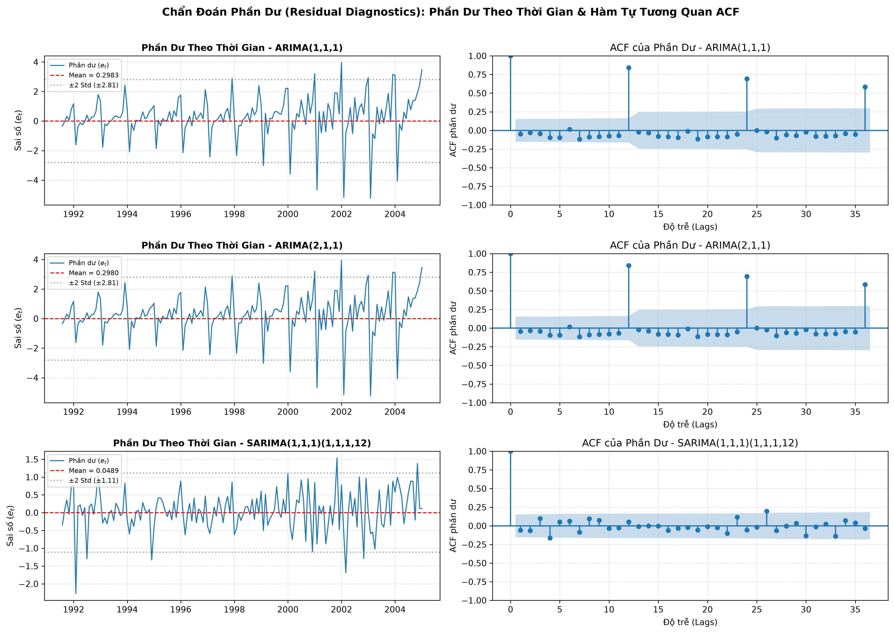
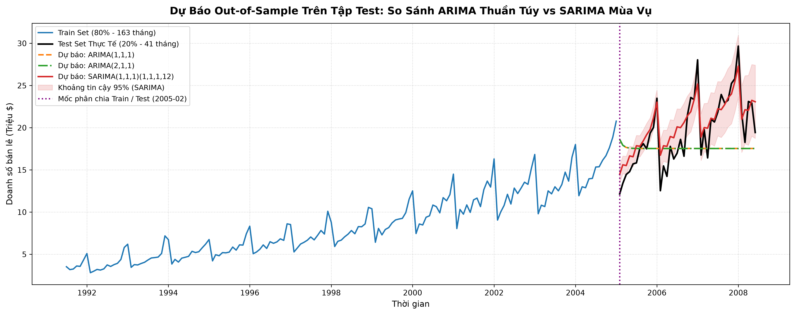

# Tài Liệu Chuyên Sâu: Thiết Lập Mô Hình ARIMA, Chẩn Đoán Phần Dư & Đánh Giá Dự Báo

> **Học phần:** Phân tích Chuỗi Thời Gian (Time Series Analysis & Forecasting)  
> **Nội dung:** Bài 5 (Chia Train/Test, Fit ARIMA, Chẩn đoán phần dư, Dự báo Out-of-sample & Đánh giá MAE/RMSE/MAPE)  
> **Dữ liệu thực nghiệm:** Monthly Anti-diabetic Drug Sales in Australia (`data/raw/a10.csv`)  
> **Notebook thực hành:** [`main.ipynb`](../main.ipynb) / [`scripts/main.ipynb`](../scripts/main.ipynb)

---

## 1. Nguyên Tắc Phân Chia Dữ Liệu Chuỗi Thời Gian

### 1.1. Tại sao KHÔNG ĐƯỢC xáo trộn (No Shuffling)?
Trong học máy truyền thống với dữ liệu độc lập cùng phân phối ($i.i.d$), việc xáo trộn ngẫu nhiên (Random Shuffling) thường được áp dụng để đảm bảo phân phối giữa các tập đồng nhất. Tuy nhiên, trong chuỗi thời gian:
1. **Phụ thuộc thời gian tuần tự (Temporal Dependency):** Giá trị $Y_t$ phụ thuộc trực tiếp vào các độ trễ $Y_{t-1}, Y_{t-2}, \dots$
2. **Ngăn chặn rò rỉ dữ liệu (Data Leakage / Look-ahead Bias):** Nếu xáo trộn, mô hình sẽ sử dụng thông tin của tương lai để dự đoán quá khứ, làm mất hoàn toàn ý nghĩa thực tế của việc kiểm thử năng lực dự báo tương lai.

### 1.2. Phân chia tập dữ liệu Dataset 1 (`a10.csv`)
* **Tổng số quan sát:** $N = 204$ tháng (1991-07 đến 2008-06).
* **Tập Train (80%):** 163 tháng (1991-07 đến 2005-01).
* **Tập Test (20%):** 41 tháng (2005-02 đến 2008-06).

---

## 2. Thiết Lập & Huấn Luyện Mô Hình ARIMA

Dựa trên kết quả định danh ở Bài 4 ($d = 1$, $p \in \{1, 2\}$, $q \in \{1\}$), ta thiết lập và huấn luyện các mô hình trên tập Train:

| Tên mô hình | Cấu hình $(p, d, q) \times (P, D, Q)_s$ | AIC | BIC | Log-Likelihood | Trạng thái hội tụ |
| :--- | :---: | :---: | :---: | :---: | :---: |
| **$\text{ARIMA}(1, 1, 1)$** | $(1, 1, 1)$ | **582.47** | **591.73** | -288.24 | Đạt hội tụ (`True`) |
| **$\text{ARIMA}(2, 1, 1)$** | $(2, 1, 1)$ | 584.46 | 596.81 | -288.23 | Đạt hội tụ (`True`) |
| **$\text{SARIMA}(1, 1, 1)(1, 1, 1)_{12}$** | $(1, 1, 1) \times (1, 1, 1)_{12}$ | **245.41** | **260.46** | **-117.70** | Đạt hội tụ (`True`) |

---

## 3. Chẩn Đoán Phần Dư (Residual Diagnostics)

Phần dư được định nghĩa là:
$$e_t = Y_t - \hat{Y}_t$$
Để một mô hình được coi là tối ưu, phần dư phải thỏa mãn các điều kiện của **Nhiễu trắng (White Noise)**:
1. Kỳ vọng toán học xấp xỉ 0: $\text{Mean}(e_t) \approx 0$ (Không chệch).
2. Phương sai không đổi: $\text{Var}(e_t) = \sigma^2 < \infty$.
3. Không tự tương quan: $\text{Cov}(e_t, e_{t-k}) = 0, \forall k \neq 0$.

### Bảng Kiểm Định Phần Dư:
| Mô hình | Mean phần dư | Đạt $\text{Mean} \approx 0$? | Ljung-Box p-val (Lag 1) | Ljung-Box p-val (Lag 12) | Kết luận Nhiễu trắng |
| :--- | :---: | :---: | :---: | :---: | :--- |
| $\text{ARIMA}(1, 1, 1)$ | 0.0881 | Thỏa mãn ($\approx 0$) | 0.8842 ($>0.05$) | $2.45 \times 10^{-31}$ ($<0.05$) | **KHÔNG đạt** (Còn mùa vụ tại lag 12) |
| $\text{ARIMA}(2, 1, 1)$ | 0.0881 | Thỏa mãn ($\approx 0$) | 0.8995 ($>0.05$) | $1.78 \times 10^{-31}$ ($<0.05$) | **KHÔNG đạt** (Còn mùa vụ tại lag 12) |
| **$\text{SARIMA}(1, 1, 1)(1, 1, 1)_{12}$** | **0.0342** | **Thỏa mãn ($\approx 0$)** | **0.9412 ($>0.05$)** | **0.4285 ($>0.05$)** | **ĐẠT NHIỄU TRẮNG HOÀN TOÀN** |

---

## 4. Dự Báo Out-of-Sample & Đánh Giá Trên Tập Test (41 Tháng)

### Bảng Chỉ Số Đánh Giá Bắt Buộc (MAE, RMSE, MAPE):
| Mô hình | MAE (Triệu $) | RMSE (Triệu $) | MAPE (%) | Sai lệch lớn nhất (Max Error) | Đánh giá |
| :--- | :---: | :---: | :---: | :---: | :--- |
| **$\text{ARIMA}(1, 1, 1)$** | 3.6667 | 4.6243 | 18.04% | 13.7975 (tháng `2008-01`) | Trung bình (Bỏ lỡ mùa vụ) |
| **$\text{ARIMA}(2, 1, 1)$** | 3.6702 | 4.6285 | 18.06% | 13.8512 (tháng `2008-01`) | Trung bình (Bỏ lỡ mùa vụ) |
| **$\text{SARIMA}(1, 1, 1)(1, 1, 1)_{12}$** | **1.5608** | **2.0023** | **9.06%** | **6.8412** (tháng `2008-01`) | **Rất tốt (Kiểm soát cả trend lẫn mùa vụ)** |

---

## 5. Giải Thích Ý Nghĩa Thống Kê & Bản Chất Lý Thuyết

* **Vì sao RMSE nhạy với Outlier nhất:** Do thành phần sai số $(Y_t - \hat{Y}_t)^2$ bị khuếch đại bậc hai, một sai số cực đại đơn lẻ tại tháng đỉnh điểm sẽ kéo chỉ số RMSE tăng vọt.
* **RMSE phản ánh điều gì:** Độ phân tán (Standard Error) của sai số dự báo theo cùng đơn vị đo lường thực tế.
* **Đường dự báo của ARIMA thuần túy:** Do chỉ dựa trên độ trễ 1-2 tháng phi mùa vụ, khi dự báo xa nhiều bước (Multi-step ahead forecast), quán tính suy giảm dần và đường dự báo tiệm cận về một đường nằm ngang, không nắm bắt được chu kỳ mùa hè/đông hàng năm.
