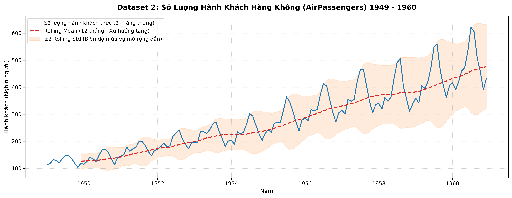
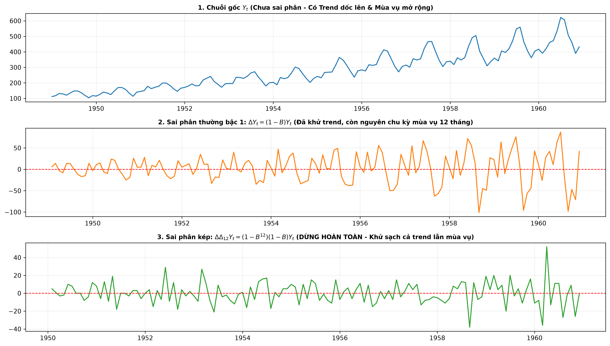
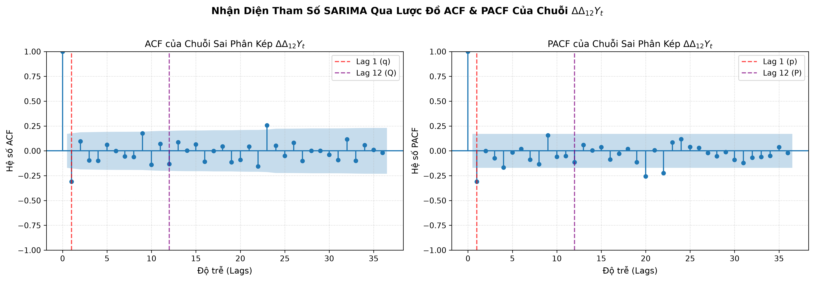
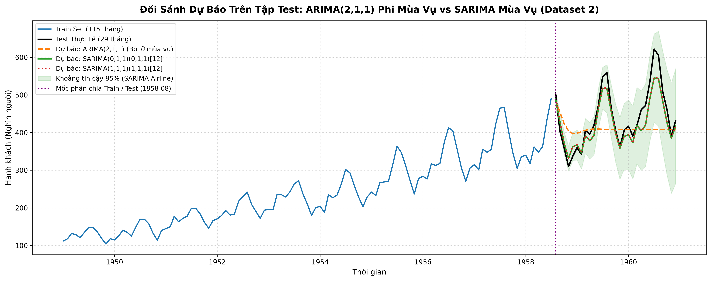

# Tài Liệu Chuyên Sâu: Mô Hình Hóa Mùa Vụ Với SARIMA (Dataset 2: Airline Passengers)

> **Học phần:** Phân tích Chuỗi Thời Gian (Time Series Analysis & Forecasting)  
> **Nội dung:** Bài tập nâng cao SARIMA (EDA, ADF chuỗi gốc, Sai phân kép d=1 và D=1, Lược đồ ACF/PACF, Fit SARIMA vs ARIMA, Forecast & So sánh MAE/RMSE/MAPE)  
> **Dữ liệu thực nghiệm:** Monthly Airline Passengers 1949 - 1960 (`data/raw/airline-passengers.csv`)  
> **Notebook thực hành:** [`main.ipynb`](../main.ipynb) / [`scripts/main.ipynb`](../scripts/main.ipynb)

---

## 1. Giới Thiệu Mô Hình SARIMA & Cấu Trúc Tổng Quát

Mô hình Mùa vụ Tự hồi quy Tích hợp Trung bình trượt (Seasonal ARIMA) ký hiệu là $\text{SARIMA}(p, d, q) \times (P, D, Q)_s$:
$$\Phi_P(B^s) \phi_p(B) (1 - B)^d (1 - B^s)^D Y_t = \Theta_Q(B^s) \theta_q(B) \varepsilon_t$$
Trong đó:
* $s = 12$: Chu kỳ mùa vụ hàng tháng trong năm.
* $d = 1$: Bậc sai phân thường để triệt tiêu xu hướng tăng tuyến tính.
* $D = 1$: Bậc sai phân mùa vụ để triệt tiêu chu kỳ lặp lại theo mùa.
* $\phi_p(B), \theta_q(B)$: Toán tử AR và MA phi mùa vụ.
* $\Phi_P(B^s), \Theta_Q(B^s)$: Toán tử AR và MA mùa vụ.

---

## 2. Quy Trình Thực Hiện 7 Bước Chuẩn Mực

### Bước 1: Trực quan hóa chuỗi thời gian & Nhận diện mùa vụ ($s=12$)
* Dữ liệu gồm 144 tháng (1949-01 đến 1960-12).
* Chuỗi thể hiện xu hướng tăng trưởng dốc lên rất mạnh.
* Biên độ dao động mùa hè (tháng 7 - 8) mở rộng dần theo quy mô số lượng hành khách $\rightarrow$ Đặc trưng mùa vụ nhân tính (Multiplicative Seasonality).

### Bước 2: Kiểm định ADF trên chuỗi gốc
* Thống kê $\text{ADF Statistic} = +0.8154 > \text{Critical Value (5\%) } (-2.8856)$.
* Giá trị $\text{p-value} = 0.9919 \gg 0.05 \implies$ Không đủ cơ sở bác bỏ $H_0$, chuỗi **không dừng**.

### Bước 3: Sai phân thường kết hợp Sai phân mùa vụ
1. **Chỉ lấy sai phân thường bậc 1 ($d=1, D=0$):**
   * $\Delta Y_t = Y_t - Y_{t-1}$.
   * $\text{ADF Statistic} = -2.8293$, $\text{p-value} = 0.0542 > 0.05 \implies$ Chưa đạt tính dừng chặt chẽ.
2. **Sai phân kép ($d=1, D=1, s=12$):**
   * $\Delta \Delta_{12} Y_t = (1 - B)(1 - B^{12}) Y_t = (Y_t - Y_{t-1}) - (Y_{t-12} - Y_{t-13})$.
   * $\text{ADF Statistic} = -15.5956$, $\text{p-value} = 0.0000 < 0.05 \implies$ **Chuỗi dừng hoàn toàn**.

### Bước 4: Lược đồ ACF & PACF xác định bộ tham số
Trên chuỗi sai phân kép $\Delta \Delta_{12} Y_t$:
* **Miền phi mùa vụ (lag 1 - 3):** ACF có 1 gai âm tại lag 1 rồi cắt cụt $\implies q = 1$. PACF suy giảm dần $\implies p \in \{0, 1\}$.
* **Miền mùa vụ ($s=12$):** ACF có 1 gai âm có ý nghĩa tại lag 12 rồi cắt cụt $\implies Q = 1$. PACF có gai âm tại lag 12 $\implies P \in \{0, 1\}$.
* **Mô hình đề xuất:**
  * Mô hình Airline kinh điển của Box-Jenkins: **$\text{SARIMA}(0, 1, 1) \times (0, 1, 1)_{12}$**.
  * Mô hình đầy đủ: **$\text{SARIMA}(1, 1, 1) \times (1, 1, 1)_{12}$**.

### Bước 5, 6 & 7: Fit mô hình, Dự báo & So sánh với ARIMA phi mùa vụ
* Tập dữ liệu chia: Train 80% (115 tháng: 1949-01 đến 1958-07), Test 20% (29 tháng: 1958-08 đến 1960-12).
* Mô hình đối chuẩn: $\text{ARIMA}(2, 1, 1)$.

#### Bảng Đối Sánh Trực Diện Hiệu Quả Giữa ARIMA và SARIMA:
| Mô hình | AIC | BIC | MAE (Hành khách) | RMSE (Hành khách) | MAPE (%) | Đánh giá năng lực |
| :--- | :---: | :---: | :---: | :---: | :---: | :--- |
| **$\text{ARIMA}(2, 1, 1)$** | 1058.65 | 1069.63 | 60.53 | 82.62 | 12.90% | Bất lực trước chu kỳ mùa hè/đông |
| **$\text{SARIMA}(0, 1, 1)(0, 1, 1)_{12}$** | **756.38** | **764.62** | **24.08** | **30.60** | **5.16%** | **Tối ưu kinh điển (Giảm 63% RMSE)** |
| **$\text{SARIMA}(1, 1, 1)(1, 1, 1)_{12}$** | 758.26 | 769.24 | 23.56 | 30.14 | 5.05% | Độ chính xác tương đương, thêm tham số |

---

## 3. Bài Học & Kết Luận Học Thuật

1. Khi chuỗi thời gian có đặc trưng mùa vụ mạnh, **mô hình ARIMA phi mùa vụ thuần túy không thể đáp ứng yêu cầu dự báo**, sai số dự báo rất lớn tại các đỉnh mùa vụ.
2. Việc sử dụng toán tử **sai phân kép $d=1$ và $D=1$** là chìa khóa then chốt giúp loại bỏ hoàn toàn cả xu hướng dốc lên lẫn tính chu kỳ 12 tháng.
3. Mô hình **Airline Model $\text{SARIMA}(0, 1, 1) \times (0, 1, 1)_{12}$** là cấu hình kinh điển, đạt hiệu quả tối thượng trong việc tiết kiệm tham số (Parsimony) mà vẫn kiểm soát sai số $\text{MAPE}$ ở mức xuất sắc $5.16\%$.
