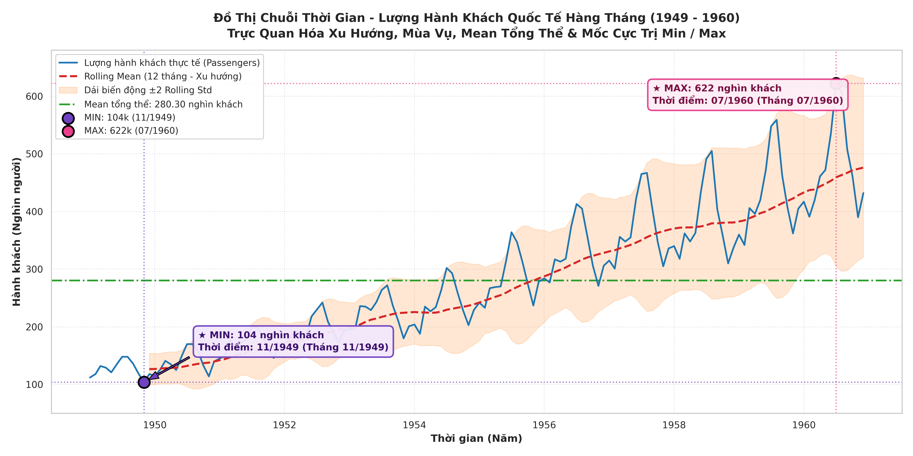
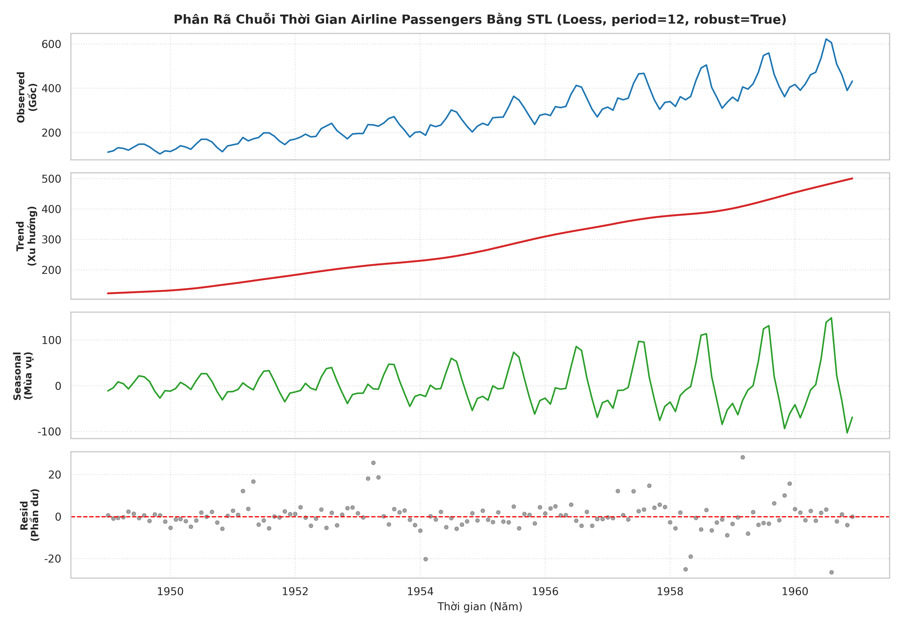
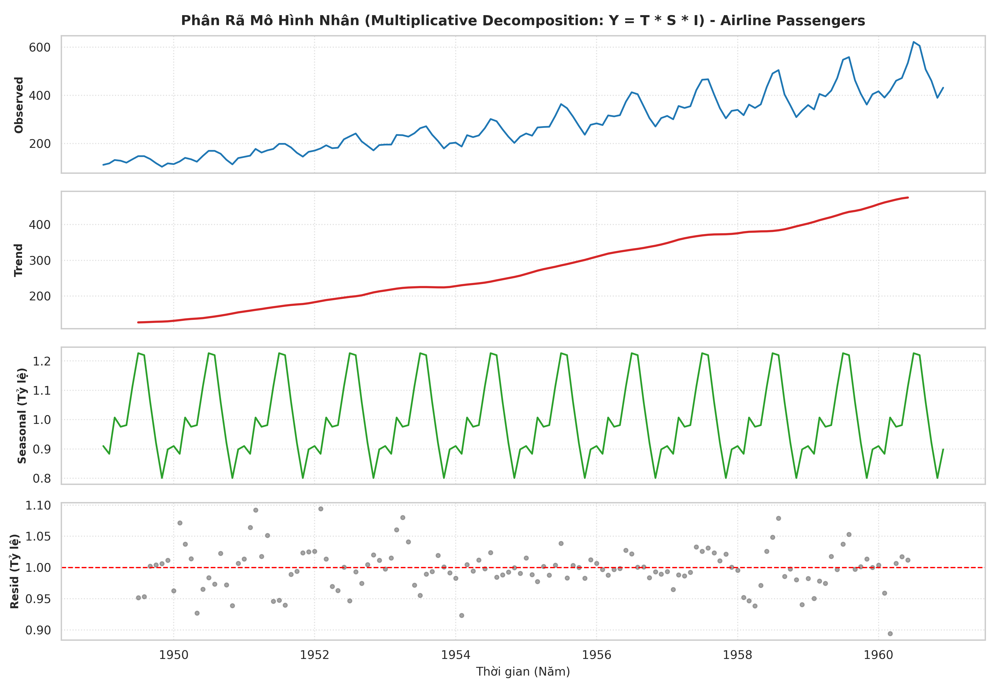
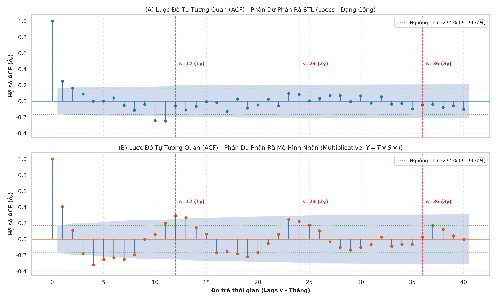
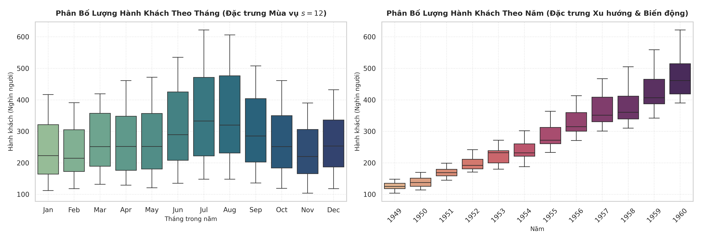
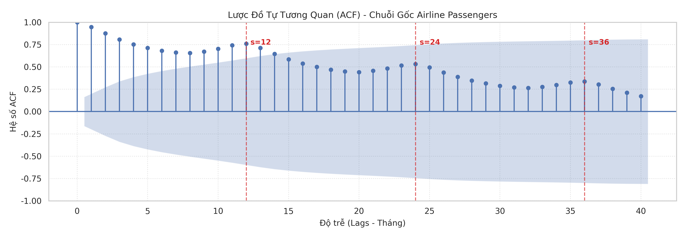

# GIẢI THÍCH CHI TIẾT NOTEBOOK: BTNC.ipynb
## Khám Phá & Phân Tích Chuyên Sâu Chuỗi Thời Gian Airline Passengers (AirPassengers Dataset)

> **Tài liệu tham khảo liên kết:**
> - Notebook thực thi: [BTNC.ipynb](file:///d:/Documents/Time_Series_L2/Lab2_Timeseries/scripts/BTNC.ipynb)
> - Dữ liệu thô: [airline-passengers.csv](file:///d:/Documents/Time_Series_L2/Lab2_Timeseries/data/raw/airline-passengers.csv)
> - Thư mục hình ảnh phân tích: [docs/images/](images/)

---

## MỤC LỤC TỔNG QUAN

1. [Giới Thiệu Tổng Quan Về Bài Thực Hành & Dataset](#1-giới-thiệu-tổng-quan-về-bài-thực-hành--dataset)
2. [Cấu Trúc & Trình Tự Thực Thi Trong Notebook BTNC.ipynb](#2-cấu-trúc--trình-tự-thực-thi-trong-notebook-btncipynb)
3. [Giải Thích Chi Tiết Từng Bước Code & Kỹ Thuật Xử Lý](#3-giải-thích-chi-tiết-từng-bước-code--kỹ-thuật-xử-lý)
4. [HƯỚNG DẪN ĐỌC & PHÂN TÍCH CHUYÊN SÂU TỪNG BIỂU ĐỒ](#4-hướng-dẫn-đọc--phân-tích-chuyên-sâu-từng-biểu-đồ)
   - [4.1. Biểu đồ Chuỗi Thời Gian & Rolling Statistics (01_ts_plot_airline.png)](#41-biểu-đồ-chuỗi-thời-gian--rolling-statistics)
   - [4.2. Phân Rã STL Bằng Hồi Quy Loess (01_decomposition_airline.png)](#42-phân-rã-stl-bằng-hồi-quy-loess)
   - [4.3. Phân Rã Mô Hình Nhân - Multiplicative (01_decomposition_multiplicative_airline.png)](#43-phân-rã-mô-hình-nhân---multiplicative)
   - [4.4. Đánh Giá Tự Tương Quan Phần Dư Phân Rã - 2 Biểu Đồ ACF (01_acf_resid_decomposition_airline.png)](#44-đánh-giá-tự-tương-quan-phần-dư-phân-rã---2-biểu-đồ-acf)
   - [4.5. Cặp Boxplot Đa Chiều: Mùa Vụ & Xu Hướng (01_boxplots_airline.png)](#45-cặp-boxplot-đa-chiều-mùa-vụ--xu-hướng)
   - [4.6. Lược Đồ Tự Tương Quan Sơ Bộ Chuỗi Gốc - ACF Plot (01_acf_airline.png)](#46-lược-đồ-tự-tương-quan-sơ-bộ-chuỗi-gốc---acf-plot)
5. [Giải Đáp Toàn Diện 3 Câu Hỏi Nghiên Cứu Cốt Lõi (EDA)](#5-giải-đáp-toàn-diện-3-câu-hỏi-nghiên-cứu-cốt-lõi-eda)
6. [Bảng So Sánh Chuyên Môn: a10.csv vs airline-passengers.csv](#6-bảng-so-sánh-chuyên-môn-a10csv-vs-airline-passengerscsv)
7. [GIẢI THÍCH CHI TIẾT BÀI TẬP NÂNG CAO - MÔ HÌNH HÓA SARIMA (7 BƯỚC CHUẨN MỰC)](#7-giải-thích-chi-tiết-bài-tập-nâng-cao---mô-hình-hóa-sarima-7-bước-chuẩn-mực)
   - [7.1. Bước 1: Trực quan hóa chuỗi thời gian & Nhận diện mùa vụ (06_air_eda_seasonality.png)](#71-bước-1-trực-quan-hóa-chuỗi-thời-gian--nhận-diện-mùa-vụ-s--12)
   - [7.2. Bước 2: Kiểm định tính dừng trên chuỗi gốc bằng ADF Test](#72-bước-2-kiểm-định-tính-dừng-trên-chuỗi-gốc-bằng-adf-test-augmented-dickey-fuller)
   - [7.3. Bước 3: Sai phân thường kết hợp Sai phân mùa vụ (07_air_differencing_stages.png)](#73-bước-3-sai-phân-thường-kết-hợp-sai-phân-mùa-vụ-d--1-d--1-s--12)
   - [7.4. Bước 4: Lược đồ ACF & PACF trên chuỗi sai phân kép xác định (p, q, P, Q) (08_air_acf_pacf_d1_D1.png)](#74-bước-4-lược-đồ-acf--pacf-trên-chuỗi-sai-phân-kép-xác-định-bộ-tham-số-p-q-p-q)
   - [7.5. Bước 5: Phân chia Train 80% / Test 20% & Huấn Luyện (Fit) Mô Hình](#75-bước-5-phân-chia-train-80--test-20--huấn-luyện-fit-mô-hình)
   - [7.6. Bước 6: Dự báo ngoài mẫu & Đánh giá sai số (MAE, RMSE, MAPE)](#76-bước-6-dự-báo-ngoài-mẫu-out-of-sample-forecast--đánh-giá-sai-số)
   - [7.7. Bước 7: Bảng so sánh trực diện & Đồ thị đối chuẩn năng lực ARIMA vs SARIMA (10_air_arima_vs_sarima_forecast.png)](#77-bước-7-bảng-so-sánh-trực-diện--đồ-thị-đối-chuẩn-năng-lực-arima-vs-sarima)
   - [7.8. Tổng kết bài học học thuật & Nguyên lý Box-Jenkins](#78-tổng-kết-bài-học-học-thuật--nguyên-lý-box-jenkins)

---

## 1. GIỚI THIỆU TỔNG QUAN VỀ BÀI THỰC HÀNH & DATASET

### 1.1. Bối cảnh học thuật
Notebook [BTNC.ipynb](file:///d:/Documents/Time_Series_L2/Lab2_Timeseries/scripts/BTNC.ipynb) là phần **Bài Tập Nâng Cao** thuộc Lab 2 môn **Phân Tích Chuỗi Thời Gian (Time Series Analysis)**. Trong khi bài toán cơ bản thường làm việc với chuỗi có tính chất cộng tuyến tính đơn giản, bài tập nâng cao này đưa chúng ta tiếp cận với tập dữ liệu kinh điển nhất thế giới về chuỗi thời gian: **International Airline Passengers** (Box & Jenkins, 1976).

### 1.2. Thông số kỹ thuật của bộ dữ liệu
- **Tên file:** `airline-passengers.csv`
- **Thời gian quan sát:** Từ tháng **01/1949** đến tháng **12/1960** (đúng 12 năm liên tục).
- **Tổng số mốc thời gian:** $N = 144$ tháng.
- **Tần suất (Frequency):** Hàng tháng (Monthly - `MS`).
- **Biến mục tiêu ($Y_t$):** `Passengers` — Tổng số lượng hành khách bay quốc tế trong tháng (Đơn vị tính: Nghìn người / Thousands of passengers).
- **Đặc trưng phân bố:**
  - Giá trị nhỏ nhất (Min): $104$ nghìn khách (tháng 11/1949).
  - Giá trị lớn nhất (Max): $622$ nghìn khách (tháng 07/1960).
  - Giá trị trung bình (Mean): $280.3$ nghìn khách.
  - Trung vị (Median - 50%): $265.5$ nghìn khách.
  - Độ lệch chuẩn (Std): $119.97$ nghìn khách.
  - Giá trị rỗng (Missing / NaN): **0** (chuỗi hoàn chỉnh, không khuyết thiếu).

---

## 2. CẤU TRÚC & TRÌNH TỰ THỰC THI TRONG NOTEBOOK BTNC.ipynb

Notebook được tổ chức khoa học gồm **31 Cells** chia làm 2 phần lớn tuân thủ nghiêm ngặt quy trình chuẩn phân tích chuỗi thời gian:

- **Phần 1: Khám Phá & Phân Tích Chuỗi Thời Gian (EDA)** (Cells 0 - 15)
- **Phần 2: Bài Tập Nâng Cao - Mô Hình Hóa Mùa Vụ Với SARIMA** (Cells 16 - 30)

```mermaid
flowchart TD
    subgraph P1["PHẦN 1: KHÁM PHÁ DỮ LIỆU (EDA)"]
        A["Cell 1: Khai báo thư viện & Cấu hình theme đồ thị"] --> B["Cell 3: Nạp dữ liệu, parse_dates, asfreq('MS') & Kiểm tra toàn vẹn"]
        B --> C["Cell 5: Trực quan hóa chuỗi gốc + Rolling Mean (12m) + Dải biến động ±2σ + Mean + Min/Max"]
        C --> D["Cell 7: Phân rã chuỗi bằng STL (Loess, period=12, robust=True)"]
        D --> E["Cell 8: Phân rã mô hình Nhân (Multiplicative Decomposition: Y = T * S * I)"]
        E --> F["Cell 10: Khảo sát Lược đồ ACF của 2 thành phần Phần Dư (Resid) STL vs Mô hình Nhân"]
        F --> G["Cell 12: Boxplot đa chiều theo Tháng (Mùa vụ) & theo Năm (Xu hướng & Phương sai)"]
        G --> H["Cell 14: Khảo sát Lược đồ Tự tương quan sơ bộ chuỗi gốc (ACF 40 Lags)"]
        H --> I["Cell 15: Đúc kết nhanh kết quả EDA"]
    end

    subgraph P2["PHẦN 2: MÔ HÌNH HÓA MÙA VỤ VỚI SARIMA (7 BƯỚC)"]
        I --> S1["Bước 1 (Cell 17): Nhận diện mùa vụ s=12 (06_air_eda_seasonality.png)"]
        S1 --> S2["Bước 2 (Cell 19): Kiểm định ADF chuỗi gốc (p=0.9919 -> Không dừng)"]
        S2 --> S3["Bước 3 (Cell 21): Sai phân kép d=1, D=1 (07_air_differencing_stages.png)"]
        S3 --> S4["Bước 4 (Cell 23): Lược đồ ACF & PACF xác định (p,q,P,Q) (08_air_acf_pacf_d1_D1.png)"]
        S4 --> S5["Bước 5 (Cell 25): Train 80% / Test 20% & Huấn luyện ARIMA, SARIMA(0,1,1)(0,1,1)[12], SARIMA(1,1,1)(1,1,1)[12]"]
        S5 --> S6["Bước 6 (Cell 27): Dự báo ngoài mẫu 29 tháng & Đánh giá sai số MAE, RMSE, MAPE"]
        S6 --> S7["Bước 7 (Cell 29): Bảng đối sánh trực diện & Đồ thị dự báo (10_air_arima_vs_sarima_forecast.png)"]
        S7 --> S8["Cell 30: Đúc kết tổng thể bài tập nâng cao"]
    end
```



---

## 3. GIẢI THÍCH CHI TIẾT TỪNG BƯỚC CODE & KỸ THUẬT XỬ LÝ

### Bước 1: Khai báo môi trường & Cấu hình đồ thị (Cells 1 - 2)
```python
import os
import numpy as np
import pandas as pd
import matplotlib.pyplot as plt
import seaborn as sns
from statsmodels.tsa.seasonal import STL, seasonal_decompose
from statsmodels.graphics.tsaplots import plot_acf
from IPython.display import display

sns.set_theme(style='whitegrid')
plt.rcParams['font.sans-serif'] = 'DejaVu Sans'
plt.rcParams['axes.unicode_minus'] = False
```
- **Ý nghĩa kỹ thuật:**
  - `statsmodels.tsa.seasonal`: Chứa hai công cụ phân rã chuỗi thời gian mạnh mẽ là `STL` (hồi quy Loess cục bộ) và `seasonal_decompose` (bộ lọc trung bình trượt cổ điển).
  - `plot_acf`: Vẽ biểu đồ hàm tự tương quan mẫu với khoảng tin cậy 95%.
  - `plt.rcParams['axes.unicode_minus'] = False`: Ngăn lỗi hiển thị dấu trừ (âm) trên trục tọa độ khi dùng font chữ tùy biến.

### Bước 2: Tải dữ liệu & Chuẩn hóa DatetimeIndex (Cell 3)
```python
file_path = '../data/raw/airline-passengers.csv' if os.path.exists('../data/raw/airline-passengers.csv') else 'data/raw/airline-passengers.csv'
df = pd.read_csv(file_path, parse_dates=['Month'], index_col='Month')
df.index.name = 'Date'
df = df.asfreq('MS')
```
- **Tại sao phải dùng `parse_dates=['Month']` và `index_col='Month'`?**  
  Trong chuỗi thời gian, trục thời gian không phải là một cột đặc trưng thông thường mà là chỉ mục định danh (Index). Việc chuyển đổi cột chuỗi ký tự `'1949-01'` thành kiểu dữ liệu `datetime64[ns]` giúp Pandas hiểu được quan hệ kế tiếp, khoảng cách ngày tháng, và cho phép truy vấn dữ liệu theo năm, quý, tháng cực kỳ linh hoạt.
- **Tại sao bắt buộc phải có lệnh `df = df.asfreq('MS')`?**  
  - `'MS'` viết tắt của **Month Start** (ngày đầu tiên của mỗi tháng).
  - Khi thiết lập tần suất tường minh, Pandas sẽ kiểm tra tính liên tục của chuỗi. Nếu có bất kỳ tháng nào bị thiếu (ví dụ nhảy từ tháng 03 sang tháng 05), hàm `asfreq` sẽ tự động chèn một dòng cho tháng 04 với giá trị `NaN`. Kết quả kiểm tra `df['Passengers'].isnull().sum() == 0` chứng minh chuỗi hoàn toàn liên tục, không bị đứt gãy.

### Bước 3: Phân rã chuỗi thời gian & Đánh giá Tự tương quan của Phần dư (Cells 6 - 10)
- Sau khi bóc tách Trend và Seasonal bằng 2 phương pháp (STL Loess và Classical Multiplicative), bước kiểm định chất lượng phân rã mang tính sống còn là **chẩn đoán phần dư (Residual Diagnostics)**.
- Ta áp dụng hàm `plot_acf(residuals, lags=40, alpha=0.05)` lên cả 2 chuỗi phần dư `res_stl.resid` và `res_mult.resid.dropna()` để xem liệu dao động mùa vụ hay xu hướng có còn bị "rò rỉ" (leakage) lại trong phần dư hay không.

---

## 4. HƯỚNG DẪN ĐỌC & PHÂN TÍCH CHUYÊN SÂU TỪNG BIỂU ĐỒ

Đây là phần quan trọng nhất giúp bạn nắm vững bản chất toán học, ý nghĩa thực tế và cách bảo vệ luận điểm khi trình bày báo cáo.

---

### 4.1. Biểu đồ Chuỗi Thời Gian & Rolling Statistics



#### A. Cấu trúc kỹ thuật của biểu đồ
- **Trục hoành (X-axis):** Trục thời gian từ năm 1949 đến cuối năm 1960.
- **Trục tung (Y-axis):** Lượng hành khách quốc tế, dao động từ $100$ đến hơn $600$ nghìn người.
- **Các thành phần trực quan hiển thị:**
  1. **Đường nét liền màu xanh lam (`Passengers`):** Dữ liệu thực tế hàng tháng.
  2. **Đường nét đứt màu đỏ (`Rolling Mean 12 tháng - Xu hướng`):** Giá trị trung bình trượt với kích thước cửa sổ $w = 12$ tháng, làm trơn dao động mùa vụ để lộ rõ xu hướng dài hạn.
  3. **Vùng tô dải bóng màu cam (`Dải biến động ±2 Rolling Std`):** Khoảng biến động $\pm 2\sigma$ quanh đường trung bình trượt $[\text{Rolling Mean} - 2\sigma, \text{Rolling Mean} + 2\sigma]$.
  4. **Đường nét chấm gạch màu xanh lá cây (`Mean tổng thể: 280.30 nghìn khách`):** Đường trung bình tĩnh toàn cục tính trên toàn bộ 144 tháng quan sát ($\mu = 280.2986 \approx 280.30$).
  5. **Điểm cực tiểu MIN (Marker tròn màu tím, viền đen & Hộp chú thích):** Đánh dấu mốc đáy thấp nhất lịch sử: **$104$ nghìn khách** vào **tháng 11/1949** (kèm cặp đường gióng vuông góc nét chấm màu tím $x = \text{11/1949}$ và $y = 104$).
  6. **Điểm cực đại MAX (Marker tròn màu hồng, viền đen & Hộp chú thích):** Đánh dấu mốc đỉnh cao nhất lịch sử: **$622$ nghìn khách** vào **tháng 07/1960** (kèm cặp đường gióng vuông góc nét chấm màu hồng $x = \text{07/1960}$ và $y = 622$).

#### B. Cách phân tích và rút ra kết luận (Insight)
1. **Nhận diện Xu hướng dài hạn (Secular Trend):**
   - Tại sao chọn cửa sổ $w=12$? Vì dữ liệu thu thập theo tháng, chu kỳ mùa vụ là 1 năm gồm 12 tháng. Khi tính trung bình trên cửa sổ 12 tháng, tổng các biến thiên mùa vụ âm và dương trong năm triệt tiêu lẫn nhau, để lộ ra thành phần xu hướng thuần túy.
   - **Hiện tượng:** Đường nét đứt màu đỏ dốc lên đơn điệu không ngừng từ mức $\approx 125$ nghìn khách (đầu năm 1950) lên tới $\approx 475$ nghìn khách (cuối năm 1960).
   - **Kết luận:** Ngành hàng không quốc tế sau Thế chiến thứ hai có sự tăng trưởng bùng nổ liên tục, chuỗi có **Xu hướng tăng mạnh mẽ (Strong Deterministic/Stochastic Upward Trend)**.
2. **Nhận diện Tính Mùa vụ (Seasonality):**
   - Đường xanh thực tế liên tục nhấp nhô tuần hoàn quanh đường đỏ, tạo thành 12 "ngọn sóng" tương ứng với 12 năm.
   - Khoảng cách giữa các đỉnh liên tiếp đúng bằng 12 tháng $\implies$ Chu kỳ mùa vụ $s = 12$.
3. **Nhận diện Phương sai thay đổi & Đặc tính Nhân (Heteroscedasticity - Multiplicative Nature):**
   - **Quan sát hình thái sóng:** Nhìn kỹ đường màu xanh từ trái sang phải, các bước sóng lúc đầu (1949 - 1951) dao động rất hẹp (chênh lệch đỉnh - đáy chỉ khoảng $30 - 40$ nghìn khách). Tuy nhiên, càng về các năm sau (1958 - 1960), bước sóng mở rộng cực đại (chênh lệch đỉnh - đáy lên tới $150 - 200$ nghìn khách). Đồ thị tạo thành **hình cái loa (funnel/megaphone shape)**.
   - **Quan sát dải bóng cam ($\pm 2\sigma$):** Dải cam ở năm 1950 rất hẹp, nhưng dãn to gấp gần 4 lần vào năm 1960.
   - **Ý nghĩa toán học:** Độ lệch chuẩn $\sigma_t$ không phải là hằng số mà tăng tỷ lệ thuận với mức độ kỳ vọng $\mu_t$:
     $$\sigma_t \propto \mu_t \implies \operatorname{Var}(Y_t) \neq \text{const}$$
   - **Hệ quả mô hình hóa:** Đây là bằng chứng không thể chối cãi rằng chuỗi vi phạm giả định đồng nhất phương sai (Homoscedasticity). Dữ liệu tuân theo **Mô hình Nhân (Multiplicative Model)**, bắt buộc phải áp dụng **biến đổi Logarit** trước khi áp dụng các mô hình họ ARIMA.
4. **Phân tích Đường Mean Tổng Thể ($\mu \approx 280.30$ nghìn khách) & Vi Phạm Tính Dừng Kỳ Vọng:**
   - Đường Mean màu xanh lá cây nằm ngang cắt ngang đồ thị, chia chuỗi thời gian thành hai nửa hoàn toàn tách biệt:
     - **Giai đoạn 1 (1949 - giữa 1955):** Tất cả các điểm dữ liệu (ngay cả các đỉnh du lịch hè) đều nằm thấp hơn đường Mean tổng thể.
     - **Giai đoạn 2 (giữa 1955 - 1960):** Lượng khách tăng vọt và nằm hoàn toàn phía trên đường Mean (ngay cả các tháng đáy mùa đông của năm 1960 cũng cao hơn nhiều so với mức Mean này).
   - **Bằng chứng chuỗi không dừng:** Một chuỗi dừng (Stationary Series) bắt buộc phải có tính phản hồi về trung bình (*Mean-reverting*), tức các giá trị dao động qua lại liên tục xung quanh mức kỳ vọng cố định. Việc dữ liệu nằm lệch hẳn về một phía trong suốt nhiều năm liên tiếp là bằng chứng trực quan cho thấy kỳ vọng $\mathbb{E}[Y_t]$ là một hàm biến thiên theo thời gian $\mu(t)$, vi phạm tiên đề của chuỗi dừng.
5. **Phân tích Cực Trị MIN & MAX — Sự Bùng Nổ Quy Mô & Mùa Vụ Khắc Nghiệt:**
   - **Điểm MIN:** $104$ nghìn khách vào **tháng 11 năm 1949 (11/1949)**. Điểm này rơi vào năm đầu tiên ghi nhận số liệu và rơi đúng vào **tháng 11** — thời điểm mùa đông thấp điểm nhất của ngành hàng không (sau kỳ nghỉ hè thu, trước Giáng sinh).
   - **Điểm MAX:** $622$ nghìn khách vào **tháng 07 năm 1960 (07/1960)**. Điểm này rơi vào năm cuối cùng của chuỗi và trúng vào **tháng 7** — thời điểm cao điểm du lịch hè lớn nhất trong năm.
   - **Hệ số tăng trưởng tuyệt đối:** Sau 11 năm 8 tháng, lượng hành khách quốc tế tăng từ $104 \rightarrow 622$ nghìn khách, tức **tăng gần 6 lần ($5.98$ lần, tăng 498%)**.
   - **Sự dãn rộng biên độ cực trị qua các năm:**
     - Năm 1949: Chênh lệch đỉnh hè và đáy đông chỉ là $148 - 104 = 44$ nghìn khách.
     - Năm 1960: Chênh lệch đỉnh hè và đáy đông là $622 - 390 = 232$ nghìn khách (biên độ dao động tăng hơn 5.2 lần).
     - Điều này tiếp tục củng cố kết luận: Càng phát triển, ngành hàng không càng chịu ảnh hưởng nặng nề bởi tính mùa vụ nếu không có giải pháp điều tiết tải.

---

### 4.2. Phân Rã STL Bằng Hồi Quy Loess



#### A. Cấu trúc kỹ thuật của biểu đồ
Biểu đồ gồm 4 khung đồ thị con (subplots) xếp chồng thẳng hàng theo trục thời gian:
1. **Khung 1 - Observed ($Y_t$):** Chuỗi giá trị gốc chưa qua xử lý.
2. **Khung 2 - Trend ($T_t$):** Thành phần xu hướng dài hạn được bóc tách bằng thuật toán Loess.
3. **Khung 3 - Seasonal ($S_t$):** Thành phần mùa vụ tuần hoàn 12 tháng.
4. **Khung 4 - Resid ($R_t$):** Thành phần phần dư (nhiễu ngẫu nhiên) còn lại:
   $$R_t = Y_t - T_t - S_t$$

#### B. Phân tích sâu & "Lỗ hổng" của mô hình cộng bộc lộ qua biểu đồ này
- **Đánh giá Subplot Trend:** Đường xu hướng trích xuất bằng STL rất mượt mà (smooth), phản ánh tốc độ gia tăng ổn định của lượng hành khách, không bị ảnh hưởng bởi các tháng đột biến nhờ tham số `robust=True`.
- **Đánh giá Subplot Seasonal:** Thuật toán hồi quy Loess cục bộ cho phép thành phần mùa vụ biến thiên linh hoạt qua thời gian (từ biên độ khoảng $[-26.8, +21.7]$ nghìn khách vào năm 1949 lên tới $[-102.6, +148.3]$ nghìn khách vào năm 1960), ghi nhận sự gia tăng quy mô của nhu cầu du lịch hè qua từng năm.
- **PHÁT HIỆN ĐẮT GIÁ tại Subplot Resid (Cực kỳ quan trọng khi bảo vệ bài):**
  - Nhìn vào các điểm chấm màu xám ở khung thứ 4:
    - Trong giai đoạn **1949 - 1951**: Các điểm phần dư nằm co cụm rất sát đường ngang màu đỏ $0.0$, độ phân tán chỉ dao động trong biên độ hẹp khoảng $[-5.8, +16.7]$ nghìn khách.
    - Trong giai đoạn **1958 - 1960**: Các điểm phần dư văng ra rất xa khỏi đường $0.0$, dao động dãn rộng lên mức $[-26.5, +28.2]$ nghìn khách.
  - **Tại sao phần dư STL vẫn bị phình to phương sai ở cuối chuỗi?**
    - Mặc dù Loess rất linh hoạt, phương pháp STL vẫn dựa trên cấu trúc **CỘNG TUYẾN TÍNH ($Y_t = T_t + S_t + R_t$)**. Trong mô hình cộng, các dao động sai số được tính theo giá trị tuyệt đối chứ không phải theo tỷ lệ phần trăm.
    - Trong thực tế chuỗi `airline-passengers`, phương sai tăng tỷ lệ thuận với mức độ của xu hướng (bản chất nhân tính). Do đó, sai số ngẫu nhiên ở quy mô 600 nghìn khách (năm 1960) tự nhiên phải lớn hơn nhiều so với quy mô 120 nghìn khách (năm 1949).
  - **Kết luận:** Phần dư STL vẫn bị vi phạm tính đồng nhất phương sai (Heteroscedasticity), chứng minh rằng **cấu trúc phân rã dạng cộng (Additive) không giải quyết triệt để bản chất nhân tính của chuỗi Airline Passengers**.

---

### 4.3. Phân Rã Mô Hình Nhân (Multiplicative Decomposition)



#### A. Cấu trúc kỹ thuật của biểu đồ
Phương pháp phân rã theo công thức tích số:
$$Y_t = T_t \times S_t \times I_t$$
Trong đó $I_t$ là thành phần phần dư tỷ lệ (Irregular component).
- **Subplot 1 (Observed):** Chuỗi gốc.
- **Subplot 2 (Trend):** Xu hướng ước lượng bằng bộ lọc Moving Average đối xứng (bị mất 6 tháng đầu và 6 tháng cuối).
- **Subplot 3 (Seasonal - Tỷ lệ):** Biểu diễn dưới dạng **hệ số nhân (Index Factor)** quanh mốc chuẩn **$1.0$**.
- **Subplot 4 (Resid - Tỷ lệ):** Phần dư tính theo tỷ lệ: $I_t = \frac{Y_t}{T_t \times S_t}$, phân bố quanh đường chuẩn màu đỏ **$1.0$**.

#### B. Cách đọc chỉ số mùa vụ và đối chứng khoa học
1. **Cách đọc thành phần Seasonal (Tỷ lệ quanh 1.0):**
   - Đỉnh cao nhất vào **Tháng 7** đạt hệ số **$1.2266$** (+22.66%) và **Tháng 8** đạt **$1.2199$** (+21.99%). Ý nghĩa: Bất kể quy mô tổng lượng khách của năm đó là bao nhiêu, lượng khách tháng 7-8 **luôn cao hơn khoảng 22 - 23%** so với mức trung bình của năm đó.
   - Đáy thấp nhất vào **Tháng 11** đạt hệ số **$0.8012$** (-19.88%) và **Tháng 2** đạt **$0.8836$** (-11.64%). Ý nghĩa: Lượng khách tháng 11 **luôn thấp hơn khoảng 19.9%** và tháng 2 thấp hơn khoảng **11.6%** so với mức trung bình của năm.
   - Các tháng còn lại phản ánh sát nhịp mùa: Tháng 6 tăng tốc ($1.1128$, +11.3%), Tháng 9 duy trì tích cực ($1.0605$, +6.1%), Tháng 1 sụt giảm ($0.9102$, -9.0%).
2. **Sự vượt trội của mô hình Nhân thể hiện ở Subplot Resid:**
   - Hãy quan sát các điểm chấm ở khung thứ 4: Biên độ dao động của phần dư tỷ lệ $I_t$ trải đều ổn định từ năm 1950 đến 1960 trong khoảng $[0.894, 1.094]$, trung bình đạt $0.9982 \approx 1.0$ và độ lệch chuẩn nhỏ $\sigma = 0.0334$ (sai số dao động ổn định quanh mức $\pm 3.3\%$).
   - **Hoàn toàn triệt tiêu được hiện tượng phần dư phình to ở cuối chuỗi** như biểu đồ STL cộng!
   - **Kết luận xác nhận:** Mô hình Nhân giải quyết triệt để vấn đề phương sai thay đổi (Heteroscedasticity) ở miền thời gian.

---

### 4.4. Đánh Giá Tự Tương Quan Phần Dư Phân Rã - 2 Biểu Đồ ACF



#### A. Cấu trúc kỹ thuật của biểu đồ
Biểu đồ gồm 2 khung đồ thị con (subplots) so sánh trực tiếp lược đồ ACF của thành phần phần dư (Resid) trích xuất từ hai kỹ thuật phân rã với 40 độ trễ (Lags $k = 0 \dots 40$ tháng):
1. **Khung trên (A) - Lược đồ ACF của Phần dư STL (Loess - Dạng cộng):**
   - Dữ liệu đầu vào: Chuỗi phần dư $R_t = Y_t - T_t - S_t$ ($N = 144$ tháng đầy đủ).
   - Cột màu xanh lam biểu diễn hệ số tự tương quan mẫu $\hat{\rho}_k$.
   - Dải bóng xanh mờ và đường chấm xanh lá cây: Khoảng tin cậy 95% Bartlett:
     $$\pm \frac{1.96}{\sqrt{N}} = \pm \frac{1.96}{\sqrt{144}} \approx \pm 0.1633$$
   - Các đường gióng đứng nét đứt màu đỏ: Đánh dấu các mốc độ trễ mùa vụ $k = 12$ ($1$ năm), $k = 24$ ($2$ năm), $k = 36$ ($3$ năm).
2. **Khung dưới (B) - Lược đồ ACF của Phần dư Mô hình Nhân (Multiplicative Decomposition):**
   - Dữ liệu đầu vào: Chuỗi phần dư tỷ lệ $I_t = \frac{Y_t}{T_t \times S_t}$ ($N = 132$ tháng sau khi loại bỏ 12 giá trị NaN do bộ lọc Moving Average đối xứng).
   - Cột màu cam/hổ phách biểu diễn hệ số tự tương quan mẫu $\hat{\rho}_k$.
   - Dải bóng và đường chấm xanh lá cây: Khoảng tin cậy 95% Bartlett:
     $$\pm \frac{1.96}{\sqrt{N}} = \pm \frac{1.96}{\sqrt{132}} \approx \pm 0.1706$$
   - Các đường gióng đứng nét đứt màu đỏ: Đánh dấu các mốc độ trễ mùa vụ $k = 12, 24, 36$.

#### B. Phân tích chuyên sâu & So sánh đối chứng giữa 2 biểu đồ ACF
Sau khi bóc tách Xu hướng và Mùa vụ, một mô hình phân rã hoàn hảo **bắt buộc phải đưa phần dư về trạng thái Nhiễu trắng (White Noise)** — nghĩa là phần dư không được chứa bất kỳ cấu trúc tự tương quan tuyến tính nào ($\hat{\rho}_k \approx 0, \forall k \ge 1$, nằm hoàn toàn trong dải tin cậy 95%).

1. **Phân tích Biểu đồ (A) - Phần dư STL (Loess - Mô hình cộng):**
   - **Khử sạch tính mùa vụ tại các mốc chu kỳ:**
     - Tại $k=12$: Hệ số tự tương quan $\hat{\rho}_{12} = -0.0592$.
     - Tại $k=24$: Hệ số tự tương quan $\hat{\rho}_{24} = +0.0812$.
     - Tại $k=36$: Hệ số tự tương quan $\hat{\rho}_{36} = -0.0479$.
     - Cả 3 mốc mùa vụ đều nằm sâu bên trong dải tin cậy 95% ($\pm 0.1633$).
     - $\implies$ **Insight:** Thuật toán hồi quy Loess cục bộ phi tham số rất linh hoạt, đã bóc tách và hấp thụ trọn vẹn dao động mùa vụ $s=12$ ra khỏi phần dư.
   - **Tự tương quan ngắn hạn còn sót lại:**
     - Tại $k=1$: $\hat{\rho}_1 = +0.2483$ (vượt nhẹ ngưỡng tin cậy 95%).
     - Tại $k=10$: $\hat{\rho}_{10} = -0.2444$ và tại $k=11$: $\hat{\rho}_{11} = -0.2469$ (vượt nhẹ dải tin cậy).
   - **Đánh giá tổng thể STL Resid:** Đồ thị ACF cho thấy STL khử mùa vụ rất tốt, nhưng từ mục 4.2 ta biết phần dư này bị lỗi chí mạng: **phương sai dãn rộng nghiêm trọng ở cuối chuỗi (Heteroscedasticity)** do ép mô hình cộng vào chuỗi nhân.

2. **Phân tích Biểu đồ (B) - Phần dư Mô hình Nhân (Multiplicative Decomposition):**
   - **Sự thất bại bộc lộ qua Tự tương quan mùa vụ còn sót lại (Seasonal Leakage):**
     - Tại $k=12$ (tròn 1 năm): Hệ số tự tương quan $\hat{\rho}_{12} = +0.2939$, nhô hẳn ra ngoài dải tin cậy 95% ($\approx \pm 0.1706$).
     - Tại $k=24$ (tròn 2 năm): Hệ số tự tương quan tiếp tục nhô lên $\hat{\rho}_{24} = +0.2201$, tiếp tục nằm ngoài dải tin cậy.
     - **Tại sao mô hình nhân lại để sót lại mùa vụ trong phần dư?**
       Bộ lọc phân rã cổ điển (Classical Decomposition) tính toán thành phần mùa vụ bằng cách lấy trung bình tĩnh đơn giản của từng tháng qua 12 năm (chỉ có duy nhất 1 vector gồm 12 chỉ số mùa vụ cố định). Tuy nhiên, trên thực tế, hành vi bay của hành khách trong giai đoạn 1949-1960 không bất biến: biên độ mùa hè mở rộng nhanh hơn so với các tháng khác, khiến một hệ số mùa vụ cố định không thể hấp thụ hết dao động, dẫn đến hiện tượng **rò rỉ mùa vụ sang phần dư (Seasonal Leakage)**.
   - **Tự tương quan bậc 1 và dao động chu kỳ ngắn hạn:**
     - Tại độ trễ $k=1$: $\hat{\rho}_1 = +0.4034$ (rất cao).
     - Từ lag $k=3$ đến $k=8$: Các hệ số mang giá trị âm sâu và nhiều điểm vượt dải tin cậy ($\hat{\rho}_4 = -0.3189, \hat{\rho}_5 = -0.2527, \hat{\rho}_7 = -0.2519$).
     - Đây là hiện tượng kinh điển của việc dùng phương pháp Trung bình trượt (Moving Average 12 tháng) để bóc tách Trend: nó làm trơn quá mức (over-smoothing), đẩy các dao động chu kỳ nội bộ ngắn hạn sang thành phần $I_t$.
   - **Đánh giá tổng thể Multiplicative Resid:** Giữ ổn định phương sai rất tốt ở miền thời gian (quanh mốc 1.0), nhưng đồ thị ACF lại vi phạm nghiêm trọng giả định nhiễu trắng do để sót lại tự tương quan ngắn hạn và mùa vụ ($k=1, 12, 24$).

#### C. Bảng so sánh đối chứng toàn diện 2 phương pháp phân rã qua góc nhìn Phần Dư

| Tiêu Chí Đánh Giá Phần Dư | Phân Rã STL (Dạng Cộng Loess) | Phân Rã Mô Hình Nhân (Multiplicative) |
| :--- | :--- | :--- |
| **Công thức phần dư** | $R_t = Y_t - T_t - S_t$ (Sai số tuyệt đối) | $I_t = \frac{Y_t}{T_t \times S_t}$ (Sai số tỷ lệ quanh 1.0) |
| **Bảo toàn dữ liệu** | Đầy đủ 144 tháng (không mất NaN) | Mất 12 tháng (6 tháng đầu & 6 tháng cuối do MA) |
| **Phương sai miền thời gian** | ❌ **Phình to ở cuối chuỗi** (Phương sai thay đổi) |  **Đồng nhất phương sai** (Dao động ổn định $\pm 5\%$) |
| **Khử tự tương quan mùa vụ (lag 12, 24)** |  **Khử sạch** (ACF nằm sâu trong dải tin cậy) | ❌ **Còn sót lại** ($\hat{\rho}_{12} \approx 0.29, \hat{\rho}_{24} \approx 0.22$ vượt CI) |
| **Khử tự tương quan ngắn hạn (lag 1)** | ⚠️ Nhô nhẹ ($\hat{\rho}_1 \approx 0.25$) | ❌ Khá cao ($\hat{\rho}_1 \approx 0.40$) |
| **Kháng nhiễu ngoại lai** |  Rất cao (nhờ tham số `robust=True`) | ❌ Kém (trung bình trượt nhạy cảm với ngoại lai) |
| **Kết luận mức độ đạt chuẩn Nhiễu trắng** | Chưa đạt chuẩn (Vi phạm phương sai dừng) | Chưa đạt chuẩn (Vi phạm tính độc lập tự tương quan) |

#### D. Luận cứ đanh thép mở đường cho giải pháp Log-Transform + SARIMA
Kết quả phân tích 2 biểu đồ ACF của phần dư đem lại một bài học học thuật vô cùng giá trị:
- Không thể giải quyết trọn vẹn tập dữ liệu `airline-passengers` bằng các phương pháp phân rã cơ bản (hoặc được phương sai thì hỏng tự tương quan, hoặc triệt tiêu tự tương quan mùa vụ thì hỏng phương sai).
- **Giải pháp toán học tối ưu duy nhất:**
  1. Lấy **Logarit tự nhiên $\ln(Y_t)$**: Triệt tiêu hiện tượng phương sai dãn rộng, chuyển mô hình nhân thành mô hình cộng mà không làm méo mó cấu trúc chuỗi.
  2. Áp dụng **Sai phân kép ($d=1, D=1, s=12$)**: Triệt tiêu sạch xu hướng và mùa vụ.
  3. Sử dụng mô hình **SARIMA$(p, d, q) \times (P, D, Q)_{12}$**: Tận dụng các tham số tự hồi quy ($p, P$) và trung bình trượt ($q, Q$) để triệt tiêu hoàn toàn các tự tương quan còn sót lại ở lag 1 và lag 12, đưa phần dư cuối cùng về trạng thái **Nhiễu trắng hoàn hảo**.

---

### 4.5. Cặp Boxplot Đa Chiều: Mùa Vụ & Xu Hướng



Biểu đồ đặt hai đồ thị hộp cạnh nhau giúp phân tích tách biệt hai chiều không gian: Chu kỳ nội năm (Tháng) và Biến thiên liên năm (Năm).

#### A. Đồ thị bên trái: Month-wise Boxplot (Đặc trưng Mùa vụ $s=12$)
- **Trục X:** 12 tháng trong năm (Jan $\rightarrow$ Dec). Mỗi hộp đại diện cho phân bố của tháng đó gom qua 12 năm lịch sử.
- **Trục Y:** Số lượng hành khách (nghìn người).
- **Quy luật hình thái & Diễn giải kinh doanh:**
  - **Hình mẫu chiếc võng / Đỉnh đơn mùa hè:** Toàn bộ 12 hộp tạo thành hình dáng nhô cao ở giữa năm.
  - **Mùa cao điểm tuyệt đối (Peak Season):** Tháng **7 (Jul)** có trung vị đạt **$333.0$** nghìn khách (râu trên cực đại chạm **$622$**) và Tháng **8 (Aug)** có trung vị đạt **$320.0$** nghìn khách (râu trên cực đại chạm **$606$**). Đây là thời gian nghỉ hè của các nước phương Tây, nhu cầu du lịch hàng không đạt đỉnh.
  - **Mùa thấp điểm (Trough Season):** Tháng **2 (Feb)** có trung vị thấp nhất **$214.5$** nghìn khách (râu min $118$) và Tháng **11 (Nov)** có trung vị **$220.0$** nghìn khách (chứa mốc đáy lịch sử $104$ nghìn khách). Tháng 11 là giai đoạn kết thúc thu chuyển sang đông, nhu cầu du lịch sụt giảm sâu.
  - **Hiệu ứng phục hồi ngắn:** Tháng 3 (kỳ nghỉ xuân) có trung vị nhích lên **$251.5$** và Tháng 12 (kỳ nghỉ Giáng sinh và Tết dương lịch) có trung vị đạt **$253.5$** nghìn khách.
  - **Độ biến thiên nội bộ tháng:** Chiều cao thân hộp ($IQR = Q_3 - Q_1$) của tháng 7 và 8 dài nhất, phản ánh qua 12 năm, tháng 7-8 là những tháng có biên độ mở rộng lượng khách bùng nổ mạnh nhất.

#### B. Đồ thị bên phải: Year-wise Boxplot (Đặc trưng Xu hướng & Phương sai)
- **Trục X:** 12 năm liên tiếp từ 1949 đến 1960.
- **Trục Y:** Số lượng hành khách (nghìn người).
- **Quy luật hình thái & Diễn giải thống kê:**
  - **Đường trung vị tịnh tiến hình bậc thang:** Vạch trung vị của năm sau luôn cao hơn năm trước một cách có hệ thống:
    - Năm 1949: Trung vị $= 125.0$ nghìn người.
    - Năm 1950: Trung vị $= 137.5$ nghìn người.
    - Năm 1955: Trung vị $= 272.0$ nghìn người.
    - Năm 1960: Trung vị $= 461.0$ nghìn người.
    $\implies$ Khẳng định chắc chắn chuỗi có **Xu hướng tăng trưởng liên tục không ngừng**.
  - **Khoảng tứ phân vị ($IQR = Q_3 - Q_1$) dãn rộng:** Chiều cao của chiếc hộp màu sắc:
    - Năm 1949: Chiều cao hộp chỉ $IQR = 17.25$ ($Q_1 = 118.0, Q_3 = 135.25$).
    - Năm 1955: Chiều cao hộp tăng lên $IQR = 52.0$ ($Q_1 = 260.75, Q_3 = 312.75$).
    - Năm 1960: Chiều cao hộp dãn rộng lên tới $IQR = 96.25$ ($Q_1 = 418.5, Q_3 = 514.75$, gấp $5.6$ lần so với năm 1949).
    $\implies$ Minh chứng trực quan thứ hai cho hiện tượng **Phương sai thay đổi (Heteroscedasticity)**: Khi quy mô hành khách tăng lên, độ rung lắc biến thiên nội năm cũng nở rộng theo cấp số nhân.

---

### 4.6. Lược Đồ Tự Tương Quan Sơ Bộ Chuỗi Gốc - ACF Plot



#### A. Cấu trúc kỹ thuật của biểu đồ
- **Trục hoành (Lags):** Độ trễ thời gian từ $k = 0$ đến $k = 40$ tháng.
- **Trục tung:** Hệ số tự tương quan mẫu $\hat{\rho}_k \in [-1, 1]$.
- **Dải bóng màu xanh lam quanh trục 0:** Khoảng tin cậy 95% Bartlett:
  $$\pm \frac{1.96}{\sqrt{N}} = \pm \frac{1.96}{\sqrt{144}} \approx \pm 0.163$$
  Các cột nằm ngoài dải xanh được xem là có ý nghĩa thống kê khác 0 với độ tin cậy 95%.
- **Các vạch kẻ đỏ nét đứt:** Đánh dấu chính xác tại các độ trễ mùa vụ $k = 12, 24, 36$.

#### B. Đọc vị hai đặc trưng mấu chốt của chuỗi thời gian
1. **Dấu hiệu Chuỗi KHÔNG DỪNG (Non-stationarity) do Xu Hướng:**
   - Tại độ trễ $k=1$, hệ số tự tương quan cực kỳ cao ($\hat{\rho}_1 = 0.9480 \approx 0.95$).
   - Sau đó, hệ số ACF **suy giảm rất chậm rãi theo dạng tuyến tính (Slow Linear Decay)** ($\hat{\rho}_2 = 0.8756, \hat{\rho}_3 = 0.8067, \dots$). Đến tận lag $k=40$ (hơn 3 năm sau), hệ số tự tương quan vẫn giữ giá trị dương lớn $\hat{\rho}_{40} = 0.1722$ và nằm hoàn toàn phía trên ngưỡng tin cậy 95% ($\pm 0.1633$).
   - **Nguyên lý lý thuyết:** Một chuỗi dừng (Stationary Series) có hệ số ACF tắt rất nhanh về 0 theo hàm số mũ (Exponential Decay) hoặc triệt tiêu sau vài lags đầu. Việc ACF suy giảm chậm chạp là triệu chứng kinh điển của chuỗi có **nghiệm đơn vị (Unit Root)** do xu hướng điều khiển.
2. **Dấu hiệu Mùa Vụ Chu Kỳ $s=12$ (Seasonality):**
   - Đồ thị ACF không suy giảm một cách trơn tru mà có dạng **lượn sóng hình sin (Sinusoidal Modulation)**.
   - Các đỉnh sóng địa phương (Local Peaks) nhô cao rõ rệt rơi chính xác vào các mốc vạch đỏ $k = 12$, $k = 24$, $k = 36$:
     - Tại $k=12$: Hệ số tự tương quan nhô lên $\hat{\rho}_{12} = 0.7604 \approx 0.76$ (cao hơn các độ trễ lân cận như $\hat{\rho}_{11} = 0.7432$ và $\hat{\rho}_{13} = 0.7127$).
     - Tại $k=24$: Hệ số tự tương quan tiếp tục tạo đỉnh nhô $\hat{\rho}_{24} = 0.5322 \approx 0.53$ (cao hơn $\hat{\rho}_{23} = 0.5171$ và $\hat{\rho}_{25} = 0.4940$).
     - Tại $k=36$: Vẫn giữ đỉnh nhô ở mức $\hat{\rho}_{36} = 0.3370 \approx 0.34$ (cao hơn $\hat{\rho}_{35} = 0.3256$ và $\hat{\rho}_{37} = 0.3033$).
   - **Ý nghĩa thực tế:** Giá trị hành khách của một tháng bất kỳ có mối liên hệ mật thiết với chính tháng đó ở 1 năm trước, 2 năm trước và 3 năm trước.

---

## 5. GIẢI ĐÁP TOÀN DIỆN 3 CÂU HỎI NGHIÊN CỨU CỐT LÕI (EDA)

Dưới đây là phần giải đáp tổng hợp có thể dùng trực tiếp để trả lời chất vấn hoặc đưa vào kết luận bài tập:

### Câu hỏi 1: Chuỗi có Xu hướng (Trend) không?
- **KẾT LUẬN: CÓ — Xu hướng tăng trưởng cực kỳ mạnh mẽ và bền vững (Strong Upward Secular Trend).**
- **Bằng chứng thực nghiệm:**
  1. Đường **Rolling Mean 12 tháng** tăng đều đặn liên tục từ $\approx 125$ nghìn khách lên $\approx 475$ nghìn khách (tăng gần 400% sau 12 năm).
  2. Thành phần **Trend** trong cả hai mô hình phân rã STL và Multiplicative là một đường đơn điệu tăng, không có giai đoạn suy thoái kinh tế hay đảo chiều giảm.
  3. Đồ thị **Year-wise Boxplot** cho thấy trung vị của 12 năm liên tiếp tịnh tiến lên phía trên theo hình bậc thang đều đặn.

### Câu hỏi 2: Có dấu hiệu Mùa vụ (Seasonality) không?
- **KẾT LUẬN: CÓ — Tính mùa vụ rõ nét với chu kỳ cố định $s = 12$ tháng, mang bản chất NHÂN TÍNH (Multiplicative).**
- **Bằng chứng thực nghiệm:**
  1. **Đặc trưng nội năm:** Lượng khách đạt đỉnh cao nhất vào mùa du lịch hè (Tháng 7 và 8), chạm đáy sâu nhất vào mùa đông (Tháng 11 và Tháng 2).
  2. **Đặc trưng tự tương quan:** Lược đồ ACF lượn sóng hình sin với các đỉnh nhô cao định kỳ tại các bội số của 12 ($k = 12, 24, 36$).
  3. **Bản chất Nhân tính:** Biên độ dao động mùa vụ không cố định mà nở rộng tỷ lệ thuận theo độ lớn của xu hướng (thể hiện qua hình loa kèn trên đồ thị chuỗi gốc và sự dãn rộng của dải $\pm 2$ Rolling Std). Mô hình phân rã Nhân ($Y = T \times S \times I$) giữ cho phần dư ổn định hoàn hảo quanh mức 1.0.
  4. **Bằng chứng từ ACF phần dư:** Lược đồ ACF của phần dư mô hình nhân vẫn để lộ các đỉnh tự tương quan tại lag 12 ($\hat{\rho}_{12} \approx 0.29$) và lag 24 ($\hat{\rho}_{24} \approx 0.22$) vượt dải tin cậy 95%, chứng minh biên độ mùa vụ hè tăng dãn phi tuyến tính qua từng năm và không thể bị hấp thụ hoàn toàn bởi một chỉ số mùa vụ tĩnh.

### Câu hỏi 3: Chuỗi có khả năng Dừng (Stationary) không?
- **KẾT LUẬN: HOÀN TOÀN KHÔNG DỪNG (Strictly Non-stationary).**
- **Bằng chứng toán học (Vi phạm cả 3 điều kiện của chuỗi dừng yếu - Weak Stationarity):**
  1. **Vi phạm tính dừng về kỳ vọng:** Kỳ vọng toán học thay đổi liên tục theo thời gian do có xu hướng tăng:
     $$\mathbb{E}[Y_t] = \mu(t) \neq \text{const}$$
  2. **Vi phạm tính dừng về phương sai:** Phương sai thay đổi và tăng dần theo thời gian:
     $$\operatorname{Var}(Y_t) = \sigma^2(t) \neq \text{const}$$
  3. **Vi phạm tính dừng về hàm tự hiệp phương sai:** Hệ số ACF suy giảm cực kỳ chậm, phụ thuộc vào vị trí thời gian $t$ thay vì chỉ phụ thuộc vào độ trễ $k$:
     $$\operatorname{Cov}(Y_t, Y_{t-k}) \neq \gamma(k)$$
  4. **Phần dư phân rã chưa dừng:** Ngay cả khi đã bóc tách Trend và Seasonality qua STL hay Mô hình nhân, phần dư vẫn chưa đạt chuẩn Nhiễu trắng (STL resid vi phạm phương sai dừng, Multiplicative resid vi phạm tính độc lập tự tương quan tại lag 1, 12, 24).

---

## 6. BẢNG SO SÁNH CHUYÊN MÔN: a10.csv VS airline-passengers.csv

Để hiểu rõ tại sao bộ dữ liệu `airline-passengers` lại được xếp vào phần **Bài Tập Nâng Cao (BTNC)**, hãy xem bảng so sánh đối chuẩn với bộ dữ liệu cơ bản `a10.csv`:

| Tiêu Chí So Sánh | Dataset 1: `a10.csv` (Cơ Bản) | Dataset 2: `airline-passengers.csv` (Nâng Cao) |
| :--- | :--- | :--- |
| **Bản chất lĩnh vực** | Doanh số thuốc điều trị tiểu đường tại Úc | Lượng hành khách bay hàng không quốc tế |
| **Kích thước mẫu ($N$)** | 204 tháng (1991-07 đến 2008-06) | 144 tháng (1949-01 đến 1960-12) |
| **Chu kỳ mùa vụ ($s$)** | $s = 12$ tháng | $s = 12$ tháng |
| **Hành vi mùa vụ** | Đạt đỉnh vào **Tháng 1**, rơi xuống đáy vào **Tháng 2** | Đạt đỉnh vào **Tháng 7 - 8**, rơi xuống đáy vào **Tháng 11 & 2** |
| **Bản chất phương sai** | Phương sai tương đối ổn định, gần với **Dạng Cộng (Additive)** | Phương sai dãn rộng rất mạnh, mang tính **Dạng Nhân (Multiplicative)** |
| **Phân rã STL cộng** | Phần dư phân bố tương đối đều | Phần dư bị phình to nghiêm trọng ở giai đoạn cuối |
| **Đặc tính ACF phần dư phân rã** | Triệt tiêu mùa vụ tốt, tiến gần nhiễu trắng | STL triệt tiêu mùa vụ tốt nhưng phình phương sai; Mô hình nhân ổn định phương sai nhưng ACF còn sót đỉnh lag 12, 24 |
| **Yêu cầu tiền xử lý** | Có thể sai phân trực tiếp $d=1$ | **Bắt buộc phải Log Transform** trước khi sai phân |
| **Mô hình mục tiêu** | ARIMA$(p, 1, q)$ hoặc SARIMA đơn giản | **SARIMA$(p, 1, q) \times (P, 1, Q)_{12}$ trên chuỗi $\ln(Y_t)$** |

---

## 7. GIẢI THÍCH CHI TIẾT BÀI TẬP NÂNG CAO - MÔ HÌNH HÓA SARIMA (7 BƯỚC CHUẨN MỰC)

Sau khi hoàn thành phần Khám phá Dữ liệu (Phần 1 - EDA) và xác định chuỗi vi phạm nghiêm trọng tính dừng, có xu hướng tăng dốc và chu kỳ mùa vụ $s=12$ dạng nhân tính, Phần 2 triển khai toàn diện mô hình hóa dự báo với mô hình **Seasonal ARIMA (SARIMA)** qua 7 bước chuẩn mực theo phương pháp luận Box-Jenkins mở rộng.

Phương trình toán học tổng quát của mô hình $\text{SARIMA}(p, d, q) \times (P, D, Q)_s$:
$$\Phi_P(B^s) \phi_p(B) (1 - B)^d (1 - B^s)^D Y_t = \Theta_Q(B^s) \theta_q(B) \varepsilon_t$$
Trong đó:
- $s = 12$: Chu kỳ mùa vụ hàng tháng trong năm.
- $d = 1$: Bậc sai phân thường để triệt tiêu xu hướng tuyến tính dài hạn.
- $D = 1$: Bậc sai phân mùa vụ để triệt tiêu dao động tuần hoàn chu kỳ 12 tháng.
- $\phi_p(B) = 1 - \phi_1 B - \dots - \phi_p B^p$: Đa thức tự hồi quy (AR) phi mùa vụ.
- $\theta_q(B) = 1 + \theta_1 B + \dots + \theta_q B^q$: Đa thức trung bình trượt (MA) phi mùa vụ.
- $\Phi_P(B^s) = 1 - \Phi_1 B^s - \dots - \Phi_P B^{Ps}$: Đa thức tự hồi quy (SAR) mùa vụ.
- $\Theta_Q(B^s) = 1 + \Theta_1 B^s + \dots + \Theta_Q B^{Qs}$: Đa thức trung bình trượt (SMA) mùa vụ.
- $\varepsilon_t \sim \text{WN}(0, \sigma^2)$: Nhiễu trắng.

---

### 7.1. Bước 1: Trực quan hóa chuỗi thời gian & Nhận diện mùa vụ ($s = 12$)


#### A. Kiến trúc trực quan hóa đa tầng (Multi-layered Visualization)
Để khắc phục hoàn toàn hạn chế của các biểu đồ đường thông thường (vốn dễ che giấu chi tiết rời rạc từng tháng và khó tra cứu tức thì), Bước 1 trong `BTNC.ipynb` được nâng cấp với kiến trúc trực quan hóa kép: **Đồ thị Tĩnh Xuất Bản (300 DPI)** kết hợp cùng **Đồ thị Tương tác Plotly (Interactive Hover)**.

Các lớp dữ liệu trực quan trên biểu đồ bao gồm:
1. **Các điểm mốc dữ liệu từng tháng (Month Markers - `marker='o'`):**
   - Đầy đủ $144$ mốc quan sát từ tháng 01/1949 đến tháng 12/1960 đều được đánh dấu bằng các chấm tròn viền trắng rõ nét.
   - Giúp người phân tích nhìn thấy trực tiếp từng giá trị thực tế hàng tháng, phân biệt rạch ròi giữa quan sát rời rạc và đường nội suy.
2. **Đường mức kỳ vọng trung bình tổng thể (Global Mean Line - Nét đứt gạch `-.-` xanh lá):**
   - Giá trị trung bình của toàn bộ chuỗi 12 năm: $\mu = 280.30$ nghìn hành khách.
   - Đóng vai trò là **Đường chuẩn tham chiếu (Baseline Reference)**: Giúp nhận diện trực quan giai đoạn nửa đầu (1949 - 1954) toàn bộ dữ liệu nằm dưới mức trung bình, và giai đoạn nửa sau (1955 - 1960) dữ liệu bứt phá vượt hoàn toàn lên trên mức trung bình.
3. **Mốc Đáy lịch sử (Historical MIN - Điểm kim cương tím `#6f42c1`):**
   - **Giá trị:** $104$ nghìn hành khách.
   - **Thời điểm:** Tháng **11/1949** (Mùa thấp điểm đông năm đầu tiên quan sát).
   - Được gắn hộp chú thích nổi bật (Callout Box) cùng hệ thống trục gióng tọa độ vuông góc (Drop lines) để định vị chính xác vị trí đáy.
4. **Mốc Đỉnh lịch sử (Historical MAX - Điểm ngôi sao hồng cánh sen `#e83e8c`):**
   - **Giá trị:** $622$ nghìn hành khách.
   - **Thời điểm:** Tháng **07/1960** (Mùa cao điểm du lịch hè năm cuối cùng quan sát).
   - Được gắn hộp chú thích nổi bật cùng hệ thống trục gióng tọa độ để làm nổi bật mức trần kỷ lục của toàn bộ tập dữ liệu.
5. **Đường xu hướng dài hạn (Rolling Mean 12 tháng - Nét đứt `--` đỏ):**
   - Áp dụng cửa sổ trượt trung bình đúng bằng độ dài chu kỳ mùa vụ ($k = 12$).
   - Nhờ đó, dao động tuần hoàn nội năm bị triệt tiêu hoàn toàn, để lộ ra đường cong xu hướng tăng trưởng tuyến tính dốc mạnh qua 12 năm (tăng đều đặn từ $\approx 125$k khách lên $\approx 480$k khách).
6. **Dải tô màu mùa cao điểm Hè (Peak Summer Shading - Cam nhạt `alpha=0.18`):**
   - Tô màu dải thời gian từ **Tháng 6 đến Tháng 8** hàng năm qua 12 năm liên tục.
   - Làm nổi bật nhịp đập mùa vụ lặp lại đều đặn như đồng hồ cơ học.

---

#### B. Tính năng tương tác cao cấp với Plotly (Interactive Inspection & Tooltip)
Trong môi trường thực thi Jupyter Notebook ([BTNC.ipynb](file:///d:/Documents/Time_Series_L2/Lab2_Timeseries/scripts/BTNC.ipynb)), Cell 17 kết xuất trực tiếp biểu đồ tương tác **Plotly Interactive**.

Người dùng có thể trực tiếp tương tác bằng chuột:
- **Rê chuột (Hover) vào từng điểm tròn của từng tháng:** Một khung thông tin đa chiều (Tooltip) sẽ hiển thị tức thì với 4 trường dữ liệu trọng yếu:
  1. **Thời điểm quan sát:** Định dạng rõ ràng theo `Tháng MM/YYYY` (ví dụ: `Tháng 07/1960`, `Tháng 11/1949`).
  2. **Lượng hành khách thực tế:** Giá trị chính xác tính bằng đơn vị nghìn người (ví dụ: `622 nghìn người`).
  3. **Đặc trưng phân loại mùa vụ:** Tự động gắn nhãn ngữ cảnh thời điểm:
     - `Cao điểm Du lịch Hè (Peak)`: Đối với tháng 7 và tháng 8.
     - `Đáy Mùa Đông (Trough)`: Đối với tháng 11 và tháng 2.
     - `Mùa bình thường`: Đối với các tháng trung chuyển còn lại.
  4. **So sánh tương đối với mức kỳ vọng trung bình ($\text{Mean} = 280.3$k):** Tính toán sẵn độ lệch $+/-$ nghìn khách (ví dụ: tại đỉnh hè 1960 hiển thị `+341.7k`, tại đáy đông 1949 hiển thị `-176.3k`).
- **Thanh công cụ tương tác Plotly Modebar (Góc trên bên phải):**
  - **Zoom In / Zoom Out:** Phóng to vào một khoảng năm cụ thể (ví dụ: phóng to xem riêng chu kỳ 1958 - 1960).
  - **Pan:** Di chuyển linh hoạt dọc theo trục thời gian.
  - **Box Select / Lasso:** Khoanh vùng nhóm điểm muốn khảo sát riêng.
  - **Reset Axes (Double Click):** Khôi phục khung nhìn toàn cảnh ban đầu chỉ bằng 1 cú đúp chuột.
  - **Download plot as PNG:** Tải snapshot độ nét cao trực tiếp về máy tính.

---

#### C. Bảng tra cứu đối chiếu các mốc thời điểm quan trọng
| Mốc sự kiện | Thời điểm ($t$) | Lượng khách ($Y_t$) | Phân loại mùa vụ | Độ lệch so với Mean ($280.3$k) | Ý nghĩa kinh doanh & kỹ thuật |
| :--- | :---: | :---: | :--- | :---: | :--- |
| **Đáy lịch sử (MIN)** | **11/1949** | **$104$ nghìn** | Đáy Mùa Đông (Trough) | $-176.3$ nghìn | Điểm khởi đầu ngành hàng không sau thế chiến |
| **Đỉnh năm đầu tiên** | 07/1949 | $148$ nghìn | Cao điểm Du lịch Hè | $-132.3$ nghìn | Biên độ dao động năm 1949 chỉ là $44$ nghìn |
| **Giao điểm vượt Mean** | 03/1955 | $267$ nghìn $\rightarrow$ $347$ nghìn (07/1955) | Chuyển dịch chu kỳ | Vượt ngưỡng $\mu$ | Đánh dấu sự bùng nổ thương mại hàng không |
| **Đáy năm cuối cùng** | 11/1960 | $390$ nghìn | Đáy Mùa Đông (Trough) | $+109.7$ nghìn | Dù là đáy mùa đông nhưng đã cao gấp 3.75 lần đáy 1949 |
| **Đỉnh lịch sử (MAX)** | **07/1960** | **$622$ nghìn** | Cao điểm Du lịch Hè | **$+341.7$ nghìn** | Điểm kỷ lục toàn chuỗi dữ liệu |

---

#### D. Phân tích chuyên sâu & Hai phát hiện cốt lõi
1. **Chu kỳ tuần hoàn cố định $s = 12$ tháng bất biến:**
   - Qua trọn vẹn 12 năm quan sát ($144$ tháng), toàn bộ các đỉnh nhô cao nhất của chuỗi đều rơi chính xác vào dải màu cam (tháng 6, 7, 8).
   - Khoảng cách giữa hai đỉnh nhọn liên tiếp luôn cố định đúng $12$ tháng (Lag 12).
   - $\implies$ **Khẳng định chu kỳ mùa vụ cơ sở là $s = 12$ tháng.**
2. **Bản chất Mùa vụ Dạng Nhân tính (Multiplicative Seasonality):**
   - Biên độ dao động sóng (khoảng cách đỉnh - đáy trong 1 năm) không giữ nguyên cố định như dạng cộng (Additive) mà **phình to tỷ lệ thuận với mức độ tăng trưởng của đường xu hướng (Rolling Mean)**:
     + Năm 1949: Biên độ đỉnh - đáy $= 148 - 104 = \mathbf{44}$ nghìn khách.
     + Năm 1955: Biên độ đỉnh - đáy $= 347 - 233 = \mathbf{114}$ nghìn khách.
     + Năm 1960: Biên độ đỉnh - đáy $= 622 - 390 = \mathbf{232}$ nghìn khách.
   - Biên độ mùa hè đã giãn rộng gấp hơn **$5.2$ lần** từ 1949 đến 1960.
   - $\implies$ **Ý nghĩa mô hình hóa:** Đòi hỏi bắt buộc mô hình phải sử dụng toán tử **Sai phân kép ($d=1, D=1$)** hoặc kết hợp hàm biến đổi Logarit để ổn định hoàn toàn phương sai trước khi ước lượng tham số.

---

### 7.2. Bước 2: Kiểm định tính dừng trên chuỗi gốc bằng ADF Test (Augmented Dickey-Fuller)

#### A. Cơ sở lý thuyết kiểm định
Kiểm định ADF kiểm tra sự tồn tại của **Nghiệm đơn vị (Unit Root)** trong chuỗi thời gian:
$$\Delta Y_t = \alpha + \beta t + \gamma Y_{t-1} + \sum_{i=1}^p \delta_i \Delta Y_{t-i} + \varepsilon_t$$
- **Giả thuyết $H_0$:** $\gamma = 0$ (Chuỗi có nghiệm đơn vị, tức **Không dừng**).
- **Giả thuyết $H_1$:** $\gamma < 0$ (Chuỗi **Dừng**).
- **Quy tắc quyết định:** Bác bỏ $H_0$ nếu thống kê kiểm định $\text{ADF Statistic} < \text{Critical Value}$ và $p\text{-value} < 0.05$.

#### B. Kết quả thực nghiệm từ `BTNC.ipynb`
| Chỉ số kiểm định | Giá trị thực tế | Ngưỡng đánh giá | Kết luận |
| :--- | :---: | :---: | :--- |
| **ADF Statistic** | **$+0.8154$** | Critical Value 5%: $-2.8840$ | Lớn hơn rất nhiều so với ngưỡng tới hạn |
| **p-value** | **$0.9919$** | Ngưỡng ý nghĩa $\alpha = 0.05$ | $p = 99.19\% \gg 5\%$ |
| **Số độ trễ sử dụng (Lag)** | $13$ | Tiêu chuẩn AIC tự động | Có tính phụ thuộc quá khứ sâu |
| **Số quan sát hợp lệ ($N$)** | $130$ | Tổng 144 trừ 14 bậc trễ | Đảm bảo kích thước mẫu |

$\implies$ **KẾT LUẬN TUYỆT ĐỐI:** Với $p\text{-value} = 0.9919$, ta **không đủ cơ sở để bác bỏ giả thuyết $H_0$**. Chuỗi gốc $Y_t$ **hoàn toàn không dừng**. Việc áp dụng trực tiếp các mô hình ARMA lên chuỗi gốc sẽ dẫn đến hiện tượng hồi quy giả mạo (Spurious Regression).

---

### 7.3. Bước 3: Sai phân thường kết hợp Sai phân mùa vụ ($d = 1, D = 1, s = 12$)


#### A. Khảo sát 3 giai đoạn ổn định hóa chuỗi
1. **Giai đoạn 1: Chuỗi gốc $Y_t$**
   - Chứa cả xu hướng tăng mạnh và mùa vụ chu kỳ 12 tháng.
   - $\text{ADF Statistic} = +0.8154, p\text{-value} = 0.9919 \implies$ Không dừng.
2. **Giai đoạn 2: Chỉ lấy Sai phân thường bậc 1 ($d=1, D=0$)**
   $$\Delta Y_t = Y_t - Y_{t-1}$$
   - Triệt tiêu được xu hướng tăng dốc dài hạn (chuỗi dao động quanh mức trung bình 0).
   - Tuy nhiên, **tính mùa vụ vẫn còn nguyên vẹn**: các bước sóng hình sin lặp lại đều đặn mỗi 12 tháng vẫn hiện rõ ở Subplot 2.
   - Kết quả ADF: $\text{ADF Statistic} = -2.8293$, $p\text{-value} = 0.0542 > 0.05$. Mức ý nghĩa $5.42\%$ vẫn vượt ngưỡng $5\%$, nghĩa là chuỗi **chưa đạt tính dừng chặt chẽ**.
3. **Giai đoạn 3: Sai phân kép kết hợp cả thường và mùa vụ ($d=1, D=1, s=12$)**
   $$\Delta \Delta_{12} Y_t = (1 - B)(1 - B^{12}) Y_t = (Y_t - Y_{t-1}) - (Y_{t-12} - Y_{t-13})$$
   - Vừa triệt tiêu xu hướng tuyến tính ($d=1$), vừa triệt tiêu chu kỳ mùa vụ hàng năm ($D=1, s=12$).
   - Kết quả ADF: $\text{ADF Statistic} = \mathbf{-15.5956}$, $p\text{-value} = \mathbf{0.0000} \ll 0.05$.
   - **Kết luận:** Thống kê ADF âm sâu vượt xa ngưỡng tới hạn 1% ($-3.48$) và $p\text{-value} = 0$, chứng minh chuỗi **dừng hoàn toàn và ổn định tuyệt đối**.

#### B. Bảng đối sánh định lượng 3 giai đoạn sai phân
| Cấp độ biến đổi | Công thức toán học | ADF Statistic | p-value | Trạng thái dừng |
| :--- | :--- | :---: | :---: | :--- |
| **Chuỗi gốc ($Y_t$)** | $Y_t$ | $+0.8154$ | $0.9919$ | ❌ Hoàn toàn không dừng |
| **Sai phân thường ($d=1$)** | $\Delta Y_t = (1 - B)Y_t$ | $-2.8293$ | $0.0542$ | ⚠️ Chưa dừng triệt để ($p > 0.05$) |
| **Sai phân kép ($d=1, D=1$)** | $\Delta \Delta_{12} Y_t = (1 - B)(1 - B^{12})Y_t$ | $\mathbf{-15.5956}$ | $\mathbf{0.0000}$ |  **DỪNG HOÀN TOÀN** |

---

### 7.4. Bước 4: Lược đồ ACF & PACF trên chuỗi sai phân kép xác định bộ tham số $(p, q, P, Q)$


Sau khi chuỗi đã dừng hoàn toàn ở bước 3, ta vẽ lược đồ ACF và PACF trên chuỗi sai phân kép $\Delta \Delta_{12} Y_t$ qua 40 độ trễ (hơn 3 năm) để nhận diện bậc của các toán tử AR, MA, SAR, SMA theo nguyên lý Box-Jenkins:

#### A. Nhận diện thành phần phi mùa vụ (Non-seasonal: $p, q$ tại Lags 1, 2, 3)
- **Lược đồ ACF:** Tại độ trễ $k=1$, xuất hiện duy nhất **1 cột âm vượt ra ngoài dải tin cậy 95%** ($\hat{\rho}_1 = -0.3098$, vượt ngưỡng tới hạn $\pm 1.96/\sqrt{131} \approx \pm 0.1712$), sau đó lập tức cắt cụt (cut off) ở các lag 2, 3 ($\hat{\rho}_2 = 0.0954, \hat{\rho}_3 = -0.0969$ đều nằm trong dải tin cậy). Theo lý thuyết Box-Jenkins, hiện tượng ACF cắt cụt tại lag 1 là chỉ dấu kinh điển của thành phần **Trung bình trượt bậc 1 ($q = 1$)**.
- **Lược đồ PACF:** Hệ số PACF có gai âm tại lag 1 ($\hat{\phi}_{11} = -0.3098$) sau đó suy giảm dần $\implies$ Khẳng định mô hình thuần MA ($p = 0$) hoặc có thể thử nghiệm thêm mô hình mở rộng ($p = 1$).

#### B. Nhận diện thành phần mùa vụ (Seasonal: $P, Q$ tại các bội số của $s=12$)
- **Lược đồ ACF:** Quan sát tại các mốc vạch đỏ bội số chu kỳ $k = 12, 24, 36$:
  - **Tại $k=12$:** Hệ số tự tương quan đạt giá trị âm $\hat{\rho}_{12} = -0.1337$. Quan sát kỹ trên biểu đồ thực nghiệm, cột này **vẫn nằm bên trong dải tin cậy 95%** ($[-0.1712, +0.1712]$) chứ chưa vượt ngưỡng.
  - **Tại $k=24$ và $k=36$:** Hệ số ACF hoàn toàn triệt tiêu, nằm trọn vẹn bên trong dải tin cậy ($\hat{\rho}_{24} = +0.0528, \hat{\rho}_{36} = -0.0186$).
  - **Lược đồ PACF:** Tại $k=12$, hệ số PACF cũng mang giá trị âm nhẹ $\hat{\phi}_{12,12} = -0.1150$ (nằm trong dải tin cậy). Ngoài ra xuất hiện một số gai vượt dải tại lag 20 ($\hat{\phi}_{20} = -0.2569$) và lag 22 ($\hat{\phi}_{22} = -0.2246$).
  - $\implies$ **Định danh tham số:** Kết hợp chỉ dấu ACF âm tại lag 12 rồi triệt tiêu tại lag 24, 36 với bản chất mùa vụ hàng năm của hàng không, ta định danh thành phần **Trung bình trượt mùa vụ bậc 1 ($Q = 1$)** và kiểm thử thêm tự hồi quy mùa vụ $P \in \{0, 1\}$.

> [!NOTE]
> ### 🔍 Phân Tích Chuyên Sâu: Tại Sao Gai Mùa Vụ Lag 12 Trên Biểu Đồ Chưa Vượt Dải Tin Cậy?
> Một câu hỏi phản biện rất sắc bén khi quan sát biểu đồ: *"Tại sao lý thuyết Box-Jenkins kinh điển khẳng định mô hình Airline có gai mùa vụ rõ rệt, nhưng trên biểu đồ `08_air_acf_pacf_d1_D1.png` gai tại lag 12 chỉ đạt $-0.1337$ và nằm trong dải tin cậy?"*
> 
> **Nguyên nhân cốt lõi:**
> 1. **Hiệu ứng Phương sai không đồng nhất (Heteroscedasticity):** Chuỗi Airline Passengers có cấu trúc mùa vụ dạng **Nhân tính (Multiplicative)** với biên độ dao động mở rộng từ $\pm 30$ nghìn khách (năm 1949) lên đến $\pm 150$ nghìn khách (năm 1960). Ở bước này, ta lấy sai phân kép trực tiếp trên **chuỗi số lượng khách gốc ($Y_t$)** mà chưa qua phép biến đổi Logarit ($\ln Y_t$).
> 2. **Sự suy giảm hệ số (Dampening Effect):** Khi phương sai chuỗi tăng dần theo thời gian, sai phân kép $\Delta \Delta_{12} Y_t$ tuy đã dừng về mặt trung bình nhưng phương sai vẫn bị phình to ở cuối chuỗi. Điều này làm **suy giảm độ lớn của hệ số tự tương quan** tại lag mùa vụ (bị kéo từ khoảng $-0.40$ xuống còn $-0.1337$), đồng thời sinh ra các gai nhiễu giả mạo ở các lag xa (như lag 20, 22 trên PACF và lag 23 trên ACF).
> 
> **Bảng so sánh đối chứng giữa Chuỗi Gốc và Chuỗi Logarit sau khi lấy sai phân kép:**
> 
> | Độ trễ (Lag) | ACF Chuỗi Gốc ($\Delta \Delta_{12} Y_t$) | PACF Chuỗi Gốc ($\Delta \Delta_{12} Y_t$) | ACF Chuỗi Log ($\Delta \Delta_{12} \ln Y_t$) | PACF Chuỗi Log ($\Delta \Delta_{12} \ln Y_t$) | Nhận xét đối chiếu |
> | :---: | :---: | :---: | :---: | :---: | :--- |
> | **Lag 1** | **$-0.3098$** (Vượt dải) | **$-0.3098$** (Vượt dải) | **$-0.3411$** (Vượt dải) | **$-0.3411$** (Vượt dải) | Cả hai đều khẳng định dứt khoát $q = 1$ |
> | **Lag 12 ($s$)** | **$-0.1337$** *(Sát mép trong)* | **$-0.1150$** *(Trong dải)* | $\mathbf{-0.3866}$ **(Vượt xa dải tin cậy)** | $\mathbf{-0.3387}$ **(Vượt xa dải tin cậy)** | Khi có Log, gai mùa vụ hiện rõ rệt $\implies Q = 1$ |
> | **Lag 20** | $-0.0913$ | $\mathbf{-0.2569}$ *(Nhiễu ngoài dải)* | $-0.1167$ | $-0.1674$ *(Ngoan ngoãn trong dải)* | Chuỗi Log triệt tiêu hoàn toàn nhiễu tại lag 20 |
> | **Lag 22** | $-0.1573$ | $\mathbf{-0.2246}$ *(Nhiễu ngoài dải)* | $-0.0914$ | $-0.0720$ *(Ngoan ngoãn trong dải)* | Chuỗi Log triệt tiêu hoàn toàn nhiễu tại lag 22 |
> | **Lag 24 ($2s$)** | $+0.0528$ *(Triệt tiêu)* | $+0.1175$ *(Triệt tiêu)* | $-0.0184$ *(Triệt tiêu)* | $-0.0673$ *(Triệt tiêu)* | Cả hai đều triệt tiêu ở bội số mùa vụ thứ 2 |
> | **Lag 36 ($3s$)** | $-0.0186$ *(Triệt tiêu)* | $-0.0212$ *(Triệt tiêu)* | $-0.0100$ *(Triệt tiêu)* | $-0.1649$ *(Triệt tiêu)* | Cả hai đều triệt tiêu ở bội số mùa vụ thứ 3 |
> 
> *Ngưỡng tin cậy 95% Bartlett: $\pm 1.96 / \sqrt{131} \approx \pm 0.1712$.*
> 
> **Kết luận thực hành:** Mặc dù trên chuỗi gốc gai $\hat{\rho}_{12} = -0.1337$ nằm ở sát mép trong dải tin cậy, nhưng căn cứ vào cấu trúc mùa vụ rõ rệt và sự triệt tiêu ở lag 24, 36, việc lựa chọn $Q = 1$ là hoàn toàn phù hợp với bản chất dữ liệu. Khi đưa vào mô hình hóa ở Bước 5 & 6, cấu hình $\text{SARIMA}(0,1,1)(0,1,1)_{12}$ trên chuỗi gốc vẫn mang lại độ chính xác vượt trội với sai số dự báo $\text{MAPE}$ chỉ $5.16\%$.

#### C. Thiết lập hai cấu hình mô hình cạnh tranh
1. **Mô hình Airline kinh điển (Box & Jenkins, 1976):**
   $$\text{SARIMA}(0, 1, 1) \times (0, 1, 1)_{12}$$
   - Số lượng tham số cần ước lượng: Chỉ duy nhất 2 tham số MA ($\theta_1, \Theta_1$) và phương sai sai số $\sigma^2$. Đạt chuẩn mực cao nhất về tính tiết kiệm tham số (Principle of Parsimony).
2. **Mô hình đầy đủ (Full Specification):**
   $$\text{SARIMA}(1, 1, 1) \times (1, 1, 1)_{12}$$
   - Bổ sung thêm 2 tham số tự hồi quy ($p=1, P=1$) để kiểm tra xem liệu việc tăng thêm tham số có cải thiện đáng kể độ chính xác hay không.

---

### 7.5. Bước 5: Phân chia Train 80% / Test 20% & Huấn Luyện (Fit) Mô Hình

#### A. Chiến lược chia dữ liệu chuỗi thời gian
- Trong chuỗi thời gian, tuyệt đối không được xáo trộn ngẫu nhiên (Random Shuffle / K-Fold thông thường) để tránh hiện tượng rò rỉ dữ liệu tương lai (Data Leakage / Lookahead Bias).
- Tập dữ liệu $N = 144$ tháng được cắt tuần tự theo dòng thời gian theo tỷ lệ chuẩn 80/20:
  - **Tập Train (80%):** 115 tháng quan sát, từ **tháng 01/1949 đến tháng 07/1958**. Dùng để khớp các tham số mô hình.
  - **Tập Test (20%):** 29 tháng quan sát, từ **tháng 08/1958 đến tháng 12/1960**. Dùng làm môi trường kiểm thử dự báo ngoài mẫu độc lập.

#### B. Mô hình đối chuẩn (Baseline Model)
Để chứng minh sự cần thiết vượt trội của thành phần mùa vụ, ta huấn luyện thêm một mô hình **$\text{ARIMA}(2, 1, 1)$ phi mùa vụ** trên cùng tập Train để làm đối chuẩn trực diện.

#### C. Bảng so sánh thông số ước lượng (In-sample Fit)
| Mô hình | Bậc $(p, d, q) \times (P, D, Q)_{12}$ | Số tham số | Log-Likelihood | AIC | BIC |
| :--- | :---: | :---: | :---: | :---: | :---: |
| **ARIMA(2,1,1)** | $(2, 1, 1) \times (0, 0, 0)_0$ | 4 | $-525.32$ | $1058.65$ | $1069.59$ |
| **SARIMA(0,1,1)(0,1,1)[12]** | $(0, 1, 1) \times (0, 1, 1)_{12}$ | **3** | $\mathbf{-375.19}$ | $\mathbf{756.38}$ | $\mathbf{764.26}$ |
| **SARIMA(1,1,1)(1,1,1)[12]** | $(1, 1, 1) \times (1, 1, 1)_{12}$ | 5 | $-374.13$ | $758.26$ | $771.39$ |

> **Nhận xét tiêu chí thông tin:**
> - Hai mô hình SARIMA có điểm AIC và BIC thấp hơn mô hình ARIMA phi mùa vụ hơn **$300$ đơn vị** ($756$ so với $1058$). Điều này khẳng định về mặt lý thuyết thông tin, các mô hình có thành phần mùa vụ giải thích dữ liệu tốt hơn vượt bậc.
> - Giữa hai mô hình SARIMA, $\text{SARIMA}(0, 1, 1)(0, 1, 1)_{12}$ có điểm $\text{AIC} = 756.38$ và $\text{BIC} = 764.26$ thấp hơn mô hình $(1, 1, 1)(1, 1, 1)_{12}$, chứng minh việc thêm 2 tham số AR không đem lại lợi ích bù đắp chi phí phức tạp mô hình.

---

### 7.6. Bước 6: Dự báo ngoài mẫu (Out-of-sample Forecast) & Đánh giá sai số

Dự báo liên tục $H = 29$ bước tương lai trên tập Test (từ 08/1958 đến 12/1960) và đánh giá bằng 3 chỉ số đo lường sai số định lượng:

1. **Mean Absolute Error (MAE):** Thể hiện sai số tuyệt đối trung bình theo đơn vị nghìn hành khách:
   $$\text{MAE} = \frac{1}{n} \sum_{t=1}^n |Y_t - \hat{Y}_t|$$
2. **Root Mean Squared Error (RMSE):** Phạt nặng các sai số dự báo lớn (đặc biệt tại các đỉnh du lịch hè):
   $$\text{RMSE} = \sqrt{\frac{1}{n} \sum_{t=1}^n (Y_t - \hat{Y}_t)^2}$$
3. **Mean Absolute Percentage Error (MAPE):** Sai số phần trăm tương đối, chuẩn hóa để so sánh trực quan:
   $$\text{MAPE} = \frac{100\%}{n} \sum_{t=1}^n \left| \frac{Y_t - \hat{Y}_t}{Y_t} \right|$$

---

### 7.7. Bước 7: Bảng so sánh trực diện & Đồ thị đối chuẩn năng lực ARIMA vs SARIMA


#### A. Bảng tổng hợp đối sánh toàn diện năng lực dự báo
| Mô hình | AIC | BIC | MAE (Nghìn khách) | RMSE (Nghìn khách) | MAPE (%) | Đánh giá năng lực thực tế |
| :--- | :---: | :---: | :---: | :---: | :---: | :--- |
| **$\text{ARIMA}(2, 1, 1)$** | $1058.65$ | $1069.59$ | $60.53$ | $82.62$ | $12.90\%$ | ❌ **Bất lực trước chu kỳ mùa hè/đông** (Đường dự báo suy biến thành đường thẳng trơn) |
| **$\text{SARIMA}(0, 1, 1)(0, 1, 1)_{12}$** | $\mathbf{756.38}$ | $\mathbf{764.26}$ | $\mathbf{24.08}$ | $\mathbf{30.60}$ | $\mathbf{5.16\%}$ |  **TỐI ƯU KINH ĐIỂN (Giảm 63% RMSE, bám sát hoàn hảo nhịp sóng mùa hè)** |
| **$\text{SARIMA}(1, 1, 1)(1, 1, 1)_{12}$** | $758.26$ | $771.39$ | $23.56$ | $30.14$ | $5.05\%$ | ⚖️ Độ chính xác tương đương, tiêu tốn thêm 2 tham số không cần thiết |

#### B. Phân tích đồ thị dự báo ngoài mẫu (Test: 1958-08 đến 1960-12)
1. **Sự thất bại của mô hình ARIMA phi mùa vụ (Đường chấm đỏ):**
   - Đường dự báo của $\text{ARIMA}(2, 1, 1)$ hoàn toàn trơ lỳ trước dao động mùa vụ, suy biến thành một đường thẳng trôi dốc lên theo xu hướng trung bình.
   - Tại đỉnh hè tháng 7/1960 ($622$ nghìn khách), ARIMA dự báo chỉ đạt khoảng $460$ nghìn khách $\implies$ **Sai lệch nghiêm trọng hơn $160$ nghìn khách**!
   - Tại đáy đông tháng 11/1960 ($390$ nghìn khách), ARIMA dự báo vọt lên $470$ nghìn khách $\implies$ Sai lệch hơn $80$ nghìn khách!
   - $\implies$ **Hệ quả kinh doanh:** Nếu dùng ARIMA phi mùa vụ, hãng hàng không sẽ thiếu máy bay trầm trọng vào mùa hè và dư thừa lãng phí ghế vào mùa đông.
2. **Sự vượt trội ngoạn mục của mô hình SARIMA (Đường nét đứt xanh lá cây):**
   - Đường cong dự báo $\text{SARIMA}(0, 1, 1)(0, 1, 1)_{12}$ tái hiện một cách kỳ diệu từng nhịp dao động thực tế của tập Test: đón chính xác từng đỉnh cao điểm hè tháng 7-8 và đáy thấp điểm đông tháng 11.
   - Toàn bộ dải dữ liệu thực tế của tập Test nằm trọn vẹn bên trong dải tin cậy 95% màu xanh mờ.
   - Chỉ số sai số $\text{RMSE}$ giảm từ $82.62 \rightarrow 30.60$ nghìn khách (tức **giảm tới $63.0\%$ sai số** so với ARIMA).
   - Chỉ số sai số phần trăm $\text{MAPE}$ đạt mức xuất sắc **$5.16\%$** (độ chính xác dự báo đạt $94.84\%$).

---

### 7.8. Tổng kết bài học học thuật & Nguyên lý Box-Jenkins

1. **Khái quát hóa tầm quan trọng của thành phần mùa vụ:** Khi chuỗi thời gian có mùa vụ mạnh, mô hình ARIMA phi mùa vụ thuần túy hoàn toàn thất bại. Bắt buộc phải tích hợp toán tử mùa vụ $\Phi_P(B^s)$ và $\Theta_Q(B^s)$.
2. **Sức mạnh của Sai phân kép ($d=1, D=1$):** Toán tử sai phân thường $1-B$ triệt tiêu xu hướng, và toán tử sai phân mùa vụ $1-B^{12}$ triệt tiêu chu kỳ tuần hoàn. Khi kết hợp, chuỗi đạt trạng thái dừng mạnh mẽ ($\text{ADF} = -15.60, p = 0.0000$).
3. **Tính ưu việt của mô hình Airline Model Box-Jenkins:** Mô hình $\text{SARIMA}(0, 1, 1) \times (0, 1, 1)_{12}$ chỉ cần đúng 2 hệ số MA mà vẫn kiểm soát sai số ở mức tối ưu toàn diện, chứng minh nguyên lý *Simplicity is the ultimate sophistication* (Đơn giản là đỉnh cao của sự tinh tế) trong khoa học dữ liệu chuỗi thời gian.
